# 样板区再增密与单体精度验收 · 2026-10-15

本轮开始前保护点：`city-detail-baseline`（b43a2c2）。美术实现提交：`ec9f8c6`；最终版本以`city-detail-review`标签为准。没有修改赛道、检查点、玩家/AI物理、速度、跳台、特技、氮气、碰撞、摄像机或比赛代码；运行时代码差异仅在`src/environment/CityDensity.ts`与`CityDensityLayout.ts`。

## 本轮数量与空间范围

| 层次 | 上轮 | 本轮 | 净增 |
|---|---:|---:|---:|
| 水岸近景 | 19 | 30 | 11 |
| 中景街区 | 38 | 60 | 22 |
| 远景轮廓 | 80 | 99 | 19 |
| 合计 | 137 | 189 | **52** |

共增加约38%，其中33处在近景/中景，19处在远景。左右两岸各增加26处，现为105与84处；两岸近景17与13、中景34与26、远景54与45。没有把灯柱、窗框、管线或广告屏算作建筑。原三栋大地标、桥、水岸设施仍另行保留。

本轮采用空隙补建，原137处模块的顺序、位置、比例、朝向均保持，经独立读取上轮布局逐项比较为一致，结果见`detail-screenshots/layout.json`。增加的是空隙中的功能建筑与街区，不把整排旧楼挪开后重新计数。

精细部分仍限制在原280m样板沿线；远景仍使用上轮±340m背景范围，未扩大到整张地图。沿用原地面承托范围和建筑保留区。所有新占地继续通过全合法水道净空和相互不重叠检查；场景模型不接入物理碰撞体。

## 增加8种原创模块，总计26种

| 新模块 | 布局数量 | 主要结构与用途 |
|---|---:|---|
| service_depot 维修服务站 | 11 | 非矩形切角墙体、检修卷帘、门柱、金属挑檐、屋顶热交换器、侧面格栅、管线、系缆柱与检修灯 |
| ferry_terminal 客运码头 | 1 | 带台阶的公共底座、环绕候船大厅、四面实体幕墙窗格、叉形支撑、上层采光区、屋檐、设备与护栏 |
| market_galleria 商业廊楼 | 4 | 双层收分体量、退台、环绕阳台、四面窗框与横缝、金属立柱、屋顶采光设施、门厅和门阶 |
| bio_lab 生物研究楼 | 6 | 两级收分曲面、结构遮阳肋、分层玻璃、外部回水管、屋顶设备平台、通信杆和入口 |
| cooling_exchange 冷却设施 | 3 | 工程底座、外散热叶片、分层隔离环、屋顶风机叶片、进水管与检修入口 |
| sail_office 帆形办公塔 | 10 | 偏心收分轮廓、曲面幕墙、弯曲脊线与冠部，远景也保留帆形结构 |
| lattice_tower 外骨骼塔楼 | 9 | 曲面倒角轮廓、实体交叉支撑、转角构件、设备层与双天线，远景保留交叉支撑 |
| commuter_hub 换乘节点 | 4 | 分叉桥墩、架空通廊、玻璃升降核心、窗框、拱肋屋面、机械导轨与公共入口 |

48处使用新模块，另4处补建港务站，合计52。没有把新模块仅留在资产库中：26类均有实际布局。高层模块在远景使用简化模型，其精细近景模板保留在库内，但不宣称驾驶时会看到这些高楼全部精细结构。

## 单体精度实际提升

不是仅增加外壳或贴灯带。本轮在既有模块上增加真实网格/曲线结构，并强化新近中景资产：

| 既有模块 | 上轮近景三角面 | 本轮 | 增加的实际结构 |
|---|---:|---:|---|
| 港务控制站 | 1,218 | 1,790 | 三层门阶、扶手、店面窗框/门把、侧面检修格栅 |
| 水岸商铺 | 2,140 | 2,712 | 入口门阶、门窗构件、两侧通风面板 |
| 观景亭 | 1,908 | 2,336 | 露台护栏立柱、入口阶梯和连接 |
| 原交通站 | 1,560 | 1,656 | 平台护栏立柱和连续扶手 |
| 控制中心 | 2,324 | 2,500 | 核心立面的嵌入式检修通风格栅 |
| 能源节点 | 1,716 | 1,748 | 两侧服务回路管线 |

新商业廊楼8,616三角面、客运码头4,436、生物研究楼3,940、换乘节点3,236。小维修站为716三角面，按小型工程设施制作，并非所有新资产都追求高面数。三角面只作预算证据，不等于美术质量验收。

四面幕墙网格沿实际曲面布置，横向分缝、凹槽、转角框与门阶是几何，不是只有正面纹理。新增近景配套包括系缆柱、服务导轨、检修灯、热交换器、回水管、散热格栅、公共台阶和平台护栏。设施围绕各建筑用途布置，没有创建随机散布的新玩法对象。

保留原16块功能屏和原41块其他标识。16块功能屏重新分配，兼顾原有与新增建筑，仍共用2048×1024图集；总数57块、114个可读面，避免继续增加独立屏幕材质和贴图。水岸功能屏从9m宽缩至5.8m，中景屏缩至8m，减少广告遮住门厅和幕墙细节的问题。

## 材质、工作流与文件

继续使用现有喷涂合金、深色密封/工程材质、银色金属、混凝土、分区玻璃与局部暖色/青色灯光PBR。商业与交通主玻璃改用已有分区蓝玻璃，并增加真实分格构件；反射、Normal、Roughness、Metallic和AO继续来自原材质体系。本轮没有新增外墙位图、替换整体光照或引入运动模糊。

模型为Blender 4.5.9原创脚本化网格/曲线/挤出/倒角/法线与UV工作流，非手工雕刻资产；保留可编辑源。没有购买或下载新模型。原ambientCG CC0和原创纹理来源继续适用，见[许可记录](../assets-license.md)。

主要文件：

- `scripts/art/city-module-infill.py`：8种新模块、曲面幕墙网格、原资产细节和新塔楼轮廓LOD。
- `scripts/art/build-city-modules.py`：接入新模块、生成实际LOD，GLB改为临时文件完整导出后原子替换。
- `assets/city-sample/source/city-modules.blend`：10,248,277字节，可编辑源。
- `public/models/city-sample/city-modules.glb`：10,528,652字节（上轮8,205,264）。
- `public/models/city-sample/city-modules-low.glb`：5,325,996字节（上轮3,869,524）。
- `modules-manifest.json`：逐模块尺寸、三角面和下载预算。
- `CityDensityLayout.ts`：新类型、带占地检查的空隙补建，未改变旧137处。
- `CityDensity.ts`：新类型标识文案和屏幕分配，继续使用原合批/实例化与LOD模块。
- `tests/city-density.test.ts`：26类/三层布局、尺寸、净空、LOD、纹理完整性和索引检查。

## 性能与兼容

继续使用三级真实几何LOD、距离迟滞、逐建筑视锥剔除。标准画质在支持`WEBGL_multi_draw`时仍按9种共享材质合批，未随26类建筑变为每栋一批。远景保持廉价轮廓，但新塔楼的帆形脊线和外骨骼没有完全丢掉；最复杂远景仍是原酒店452三角面。

低画质和无扩展环境继续使用InstancedMesh。低画质只下载低画质包，关闭附属屏幕、连接件与高成本材质细节。原16块屏共用同一图集，无新增贴图分辨率成本。

固定驾驶视角对比条件：Edge无头、1440×900、RTX 4060 Laptop GPU、模拟暂停、水面时间固定、2秒预热+5秒采样：

| 指标 | 上轮137处 | 本轮189处 |
|---|---:|---:|
| 全场景绘制调用 | 197 | 197 |
| 全场景三角面 | 467,574 | 483,474 |
| 平均RAF FPS | 约240 | 约240 |
| p95帧间隔 | 4.3ms | 4.3ms |
| 超50ms采样 | 0 | 0 |
| 几何/纹理资源计数 | 268 / 101 | 268 / 101 |

可见三角面约增加3.4%，未观察到当前设备短时卡顿。另5秒运行中键盘驾驶采样约240 RAF FPS、p95 4.3ms、最大150次调用和512,584三角面，未出现超50ms长帧。240接近测试调度上限，不能用于推断低端电脑帧率或保证所有设备60FPS。

预热后反复切换画质，几何242→242、纹理63→63，没有持续增长。无扩展回退能加载、切LOD并恢复合批；该回退的活动实例化部件更多，不代表在低端GPU上与合批同速。真实手机性能未测。

新包标准体积约增加2.32MB、低画质约增加1.46MB；原模板缓存和合批仍占CPU/GPU内存，下载成本不是零。补建占地检查只在初始化计算，不在每帧或每次比赛重跑。

## 测试结果与修复

- `npm test`：**87/87**，原驾驶/AI/碰撞/跳台/比赛回归保留。
- `npm run build`：TypeScript和生产构建成功；Three.js大于500kB的原打包提示仍存在。
- 模块检查：26类均有布局；原137处未移动；近中远数量、两岸、唯一ID、全水道净空、模型占地和相互分离通过。
- 标准/低画质GLB：有限顶点、实际LOD、尺寸预算、索引不越界、PNG/JPEG嵌入数据首尾及完整二进制长度通过。
- Edge实际键盘驱动至180km/h，HUD计时、圈数、排名、检查点提示仍更新。游戏截图中179为HUD采样显示，物理记录达到180。
- 生产页面加载：各模型HTTP200，无页面脚本错误；W加速到36、A转向输入、S降到0，重新比赛恢复倒计时和40%氮气，生产没有测试对象。
- 57块标识/114面朝向、左右UV、UV范围检查通过；原可读正反面实现未改。
- 844×390触控模拟：低画质、触控入口可见、只加载低画质城市包、无脚本错误。不是实机验收。
- 早期台阶超出模型声明边界，已收回既有占地并重导出，未扩大船只或赛道碰撞体。
- 导出期间曾复现预览读到未写完GLB、导致破面和纹理加载错误；已改为完整写入临时文件后替换公开资源，最终重新加载、完整性测试和浏览器检查通过。损坏的中间截图不作为验收截图。

本轮没有人工完整跑三圈、逐个复测所有跳台与捷径，也未做长时间低端硬件压力测试。核心文件未改和已有回归通过不能代替这些人工体验验证。

## 截图验收

所有图片来自实际游戏WebGL渲染，使用原光照与材质。模型近景仅改变摄影机，未制作概念效果图或隐藏邻近建筑；自动摄影产生的严重遮挡帧未作为验收图。下方同视角对比固定分辨率与水面时间，旧版来自本轮保护点。

| 视角 | 本轮前 | 本轮后 |
|---|---|---|
| 主水道 | 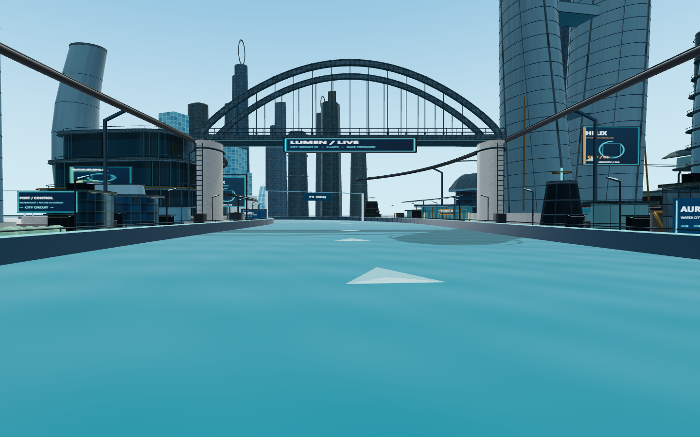 | 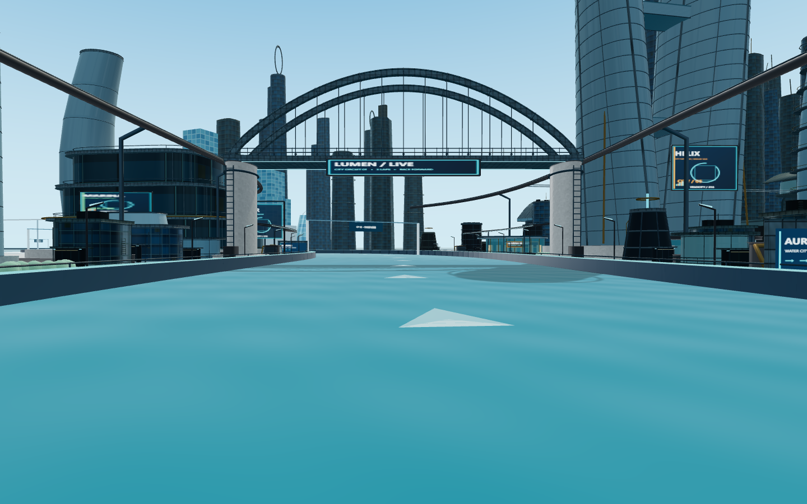 |
| 整体 | 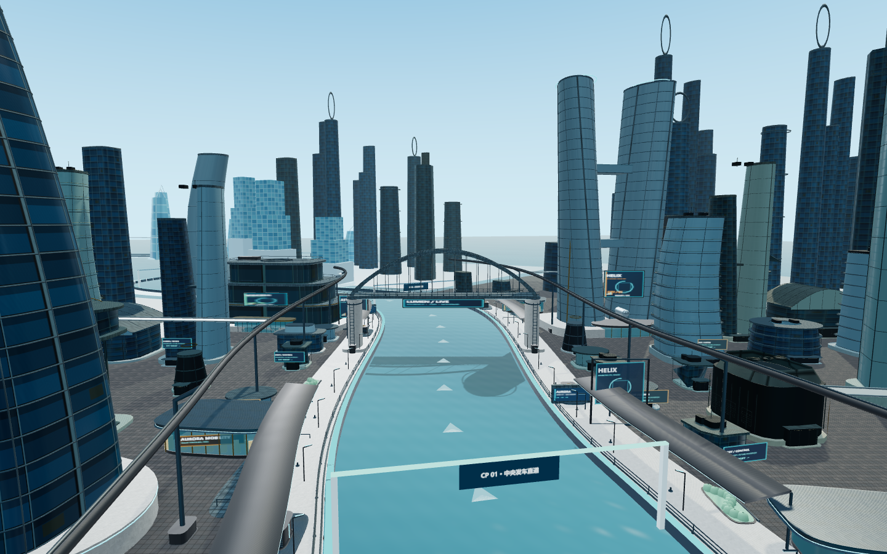 | 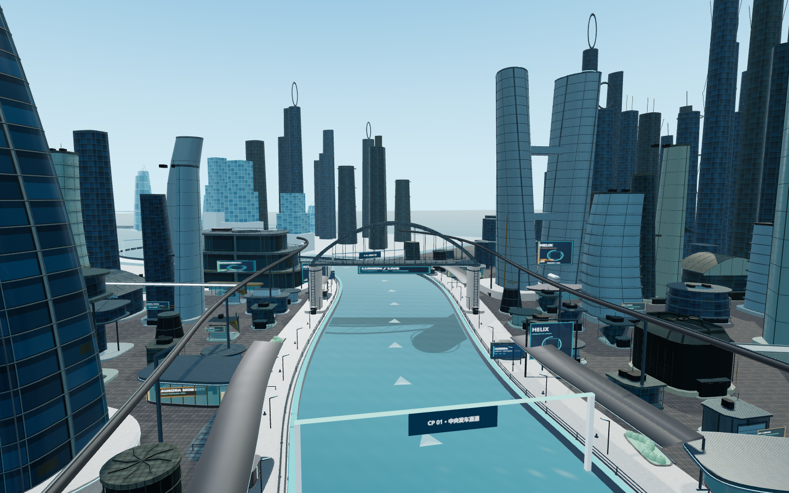 |
| 中景街区 | 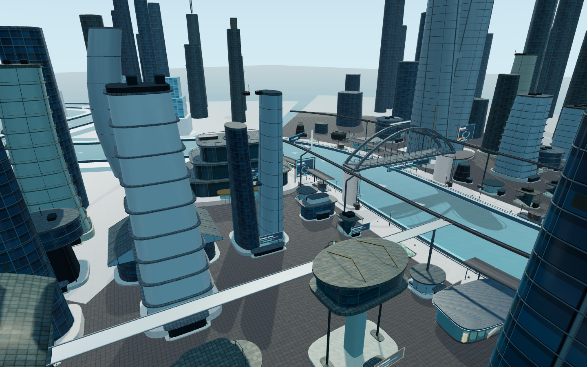 | 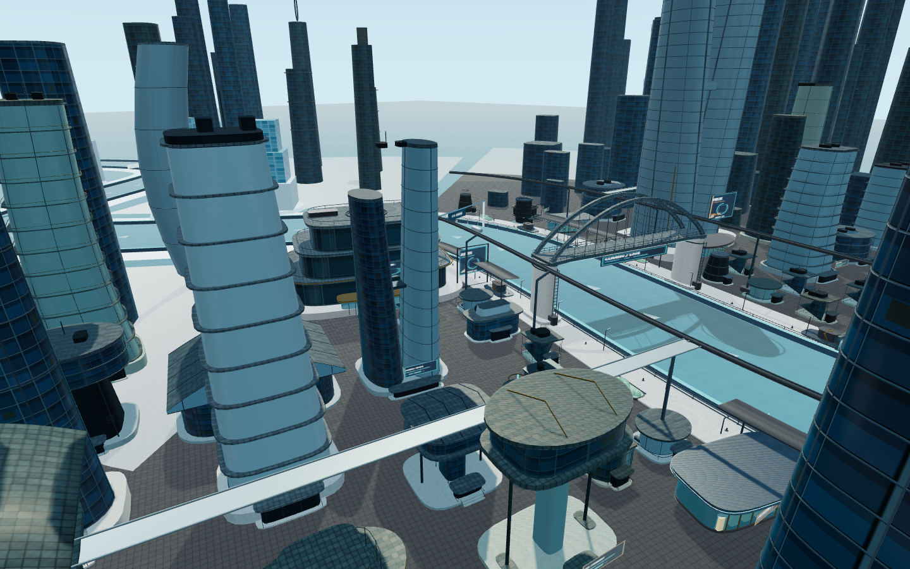 |
| 另一岸 | 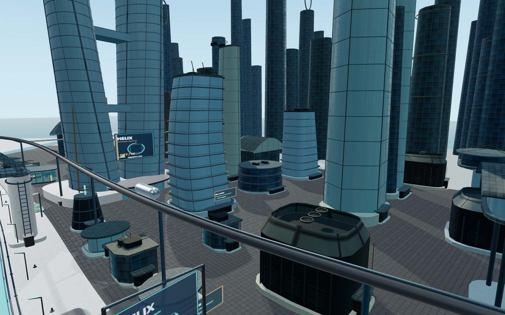 | 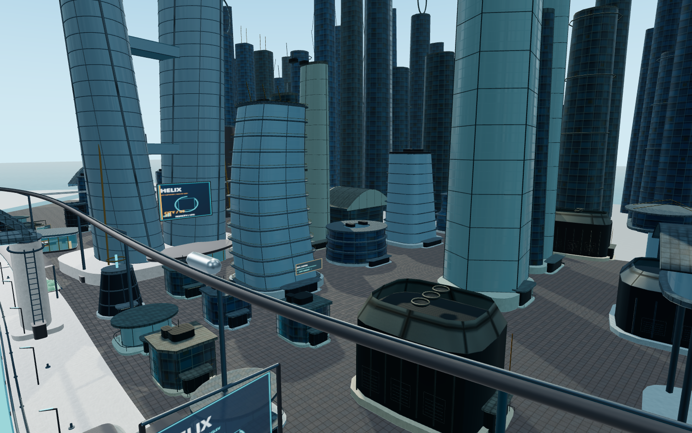 |

玩家驾驶视角：
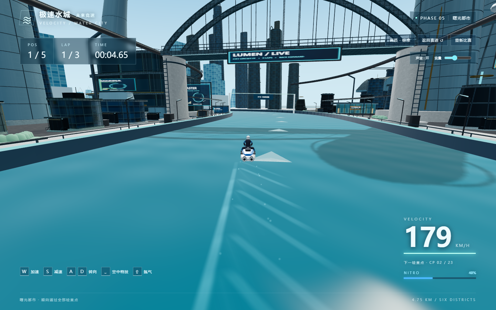

起点/主水道：
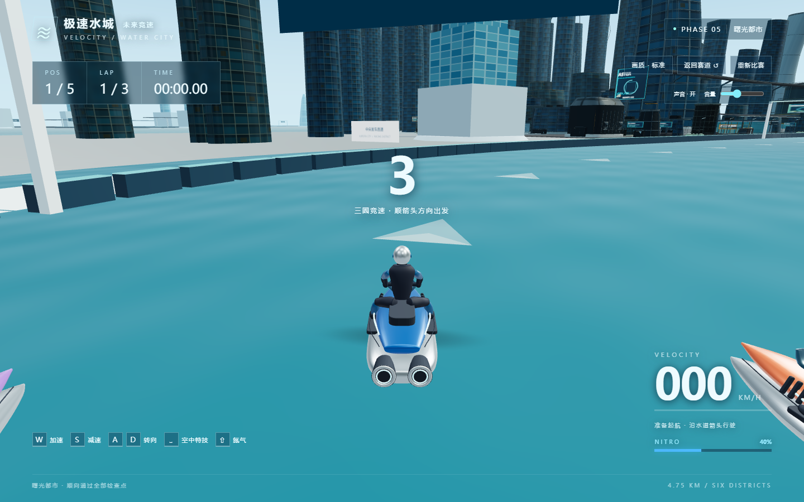

桥梁区域：
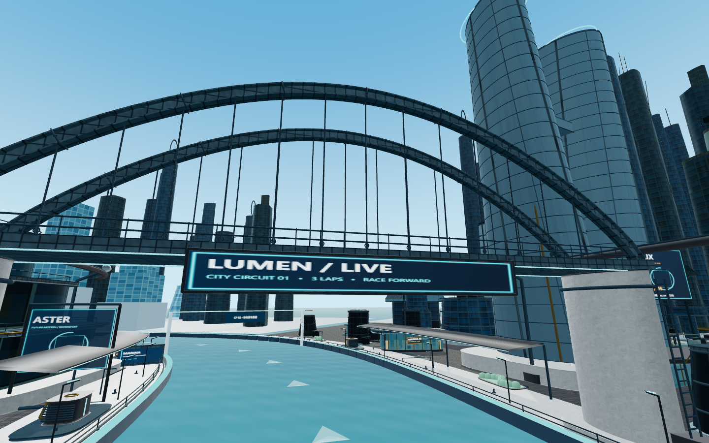

城市近景（商业廊楼）：
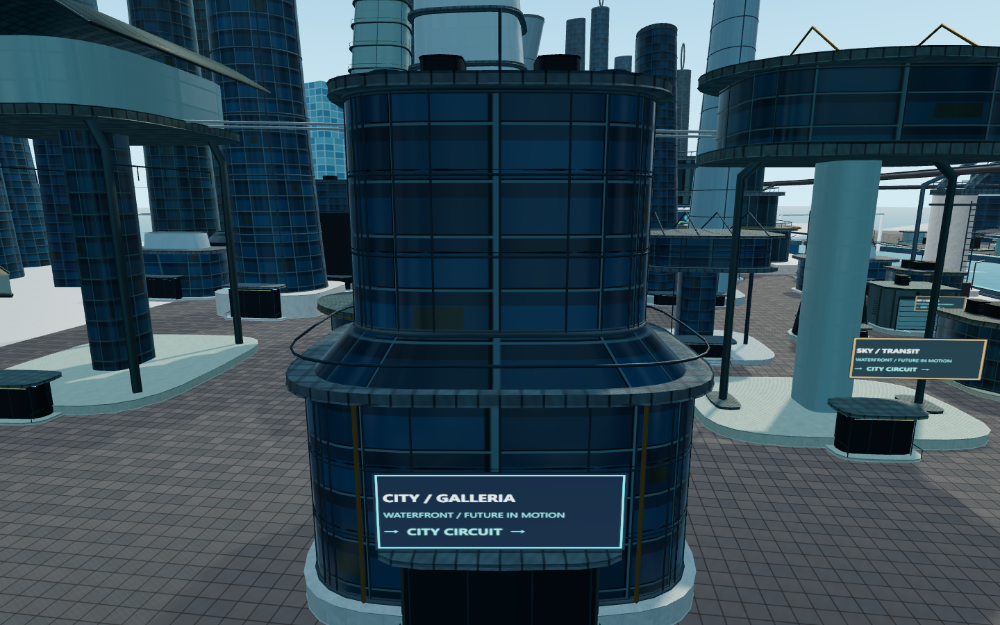

城市中景：

城市远景：
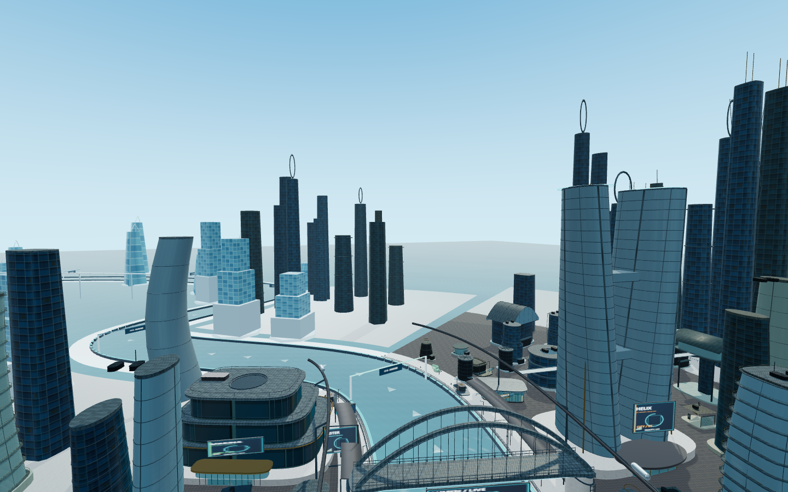

研究楼细节：
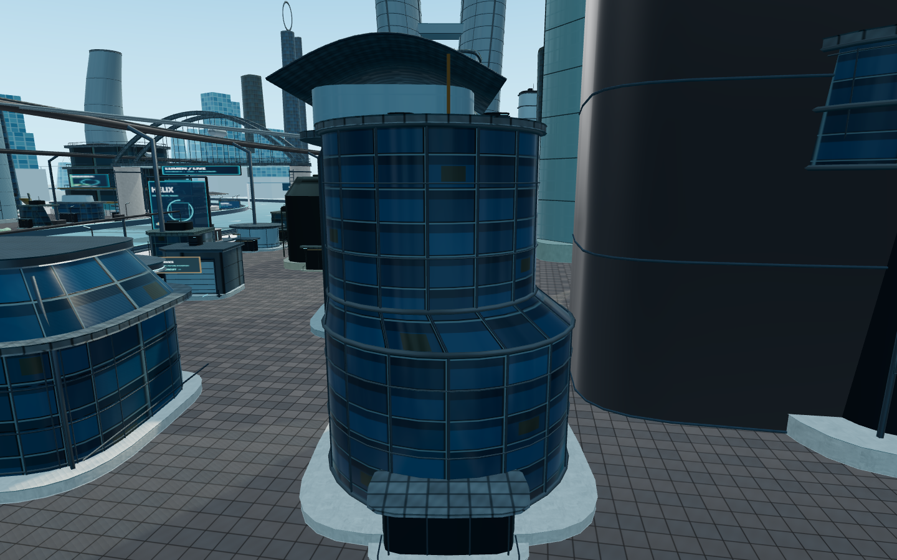

## 尚需用户验收

本轮最大的可见变化在两岸功能建筑和中景街区：商业、科研、码头、维修与交通设施同时填补空隙，并增加可辨认的窗格、退台、平台和工程构件；远景提供额外帆形与外骨骼轮廓。主水道正前方仍被原大地标遮挡，不能只凭总数推断所有新增建筑同时可见。

远景仍明显简化，部分体量/玻璃图集复用，个别平台仍空，缺少独立手绘纹理与室内美术。提高数量和面数不代表已达到《激流快艇2》成品质量。本轮等待你重点验收：近景是否足够精细、两岸街区是否更完整、160–180km/h下细节是否可感知、LOD是否显眼、普通电脑是否流畅。

完成后停止，不扩展整张地图，不修改摩托/驾驶员，不部署GitHub Pages。
