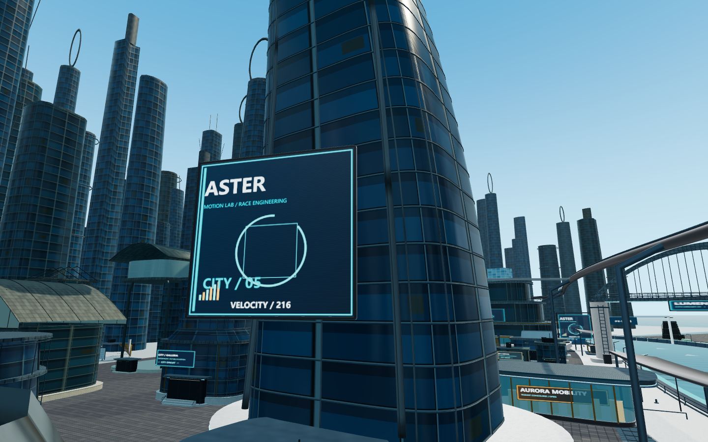
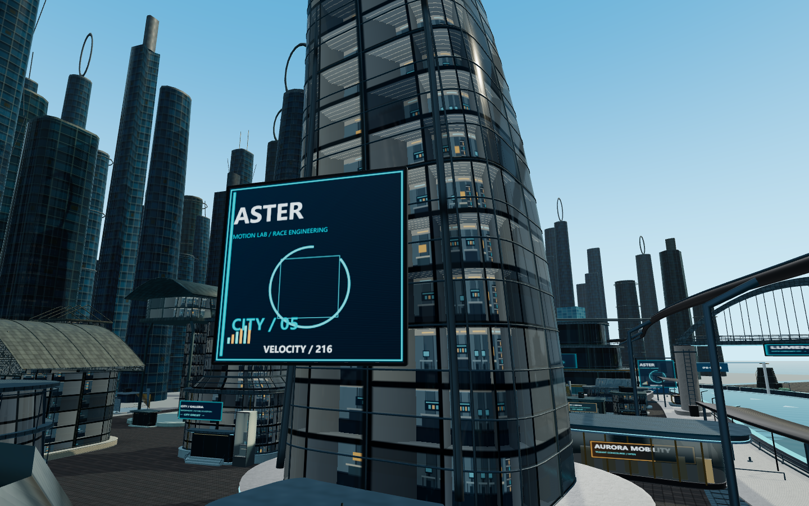
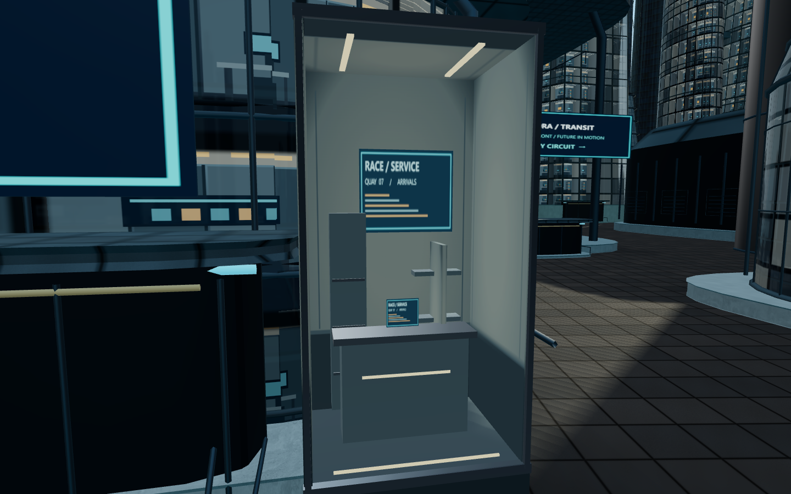

# 建筑光照、玻璃与内部空间验收 · 2026-10-15

保护点为 `city-interior-baseline`（e593ac0）。主要实现提交为 `1bbb3d9`，阴影缓存修正为 `f11f2f8`；最终验收版本标记为 `city-interior-review`。本轮保留26类、189处城市模块的布局，不再加楼。运行时代码只修改环境模块，没有修改赛道、驾驶、AI、速度、氮气、特技、跳台、碰撞、比赛、输入或摄像机代码；原GLB及Blender源未变。

## 检查发现

1. 原玻璃主要是有颜色的反射外壳；即使模型内有少量结构，也被不透明幕墙遮住，无法形成可见室内。
2. Hemisphere强度1.3与环境反射照明强度1叠加，使背光面补光过多，主光方向不够鲜明；不能仅靠提高曝光解决。
3. 近景门厅缺少能读出的柜台、隔断、天花和前后空间；基座与地面之间也缺少连续遮蔽。
4. 原有PBR、窗框、桥梁几何和局部2048阴影已经存在，适合复用。本轮没有重新建模整个街区，也没有引入后处理运动模糊。

## 实际修改

### 玻璃后的房间层次

`CityGlass.ts`为地标与模块库的玻璃材质共用一个1024×512原创图集，含8款办公室/服务/设备房间。图集绘制楼层边缘、后墙板、竖向结构、柜台、桌椅/显示器轮廓、设备架和暖/冷顶灯，窗格明暗由稳定种子区分，随时间不闪烁。

标准画质使用一次射线与假房间盒的求交，依据观察角度展示后墙、侧墙、地板和天花，不增加真实房间网格或独立光源。保留原PBR反射，降低玻璃金属度与过强反射，并根据掠射角调整内部可见程度；楼层/窗框仍由原有几何和遮罩表达。95–175m渐退，远景不计算假室内；低画质使用平面图集，不计算视差。

三栋原地标Aster、Helix、Marina和模块库玻璃均接入。高楼窗格为视觉假象，不能进入；它们不是整栋楼的真实内部建模。近距离仍能看出程序图集的简化和重复，尚未达到商业成品的美术完成度。

### 9处可见浅层服务空间

从现有近中景建筑中选择两岸代表点，不移动建筑：

| 建筑类型 | 处理数量 | 内容 |
|---|---:|---|
| 港务控制站 harbor_control | 2 | 设备柜、服务台、墙屏、顶灯 |
| 水岸商业 service_arcade | 2 | 门厅展示间、柜台、隔断、灯带 |
| 客运码头 ferry_terminal | 1 | 候船服务柜台、信息屏与设备层次 |
| 商业廊楼 market_galleria | 2 | 较高展示空间、设备架和接待台 |
| 维修站 service_depot | 2 | 检修服务窗、设备柜、工作屏 |

这些是附着在原不透明外墙前方、保留占地内的浅层服务/展示间，包含真实侧墙、地板、天花、基座、柜台、隔断、架子和透明前窗，能从侧面读出深度。不是把原建筑全部镂空，也不宣称为完整可进入大厅。每栋沿用同一套基础服务家具，后续仍可做更有差异的美术。

渲染使用7组共享几何/材质的InstancedMesh；115m外和低画质隐藏，不增加点光源。原服务站雨棚、码头曲面玻璃初期遮住新空间的问题已通过调整附着位置修正，九处分别截图检查，见下方照片与 `bay-poses.json`。

### 光照、体积与接触层次

| 项目 | 原值 | 当前值/处理 |
|---|---|---|
| Hemisphere强度 | 1.3 | 0.58；偏冷天空补光、深灰地面补光 |
| 场景环境照明强度 | 1 | 0.35，减少背光面被平均照亮 |
| Directional强度 | 3.25 | 3.7 |
| 主光相对样板中心位置 | (-110,180,100) | (-155,165,90)，更清楚的侧向受光 |
| 玻璃局部反射强度 | 约0.7 | 0.32，保留高光但露出窗后内容 |
| 原地标AO强度 | 0.7 | 0.85 |
| 阴影 | 局部2048静态阴影 | 保留，normalBias为0.025，bias为-0.00008 |
| 基座遮蔽 | 原有局部层 | 为90处近中景占地增加一层静态渐变接触遮蔽，共180三角面、1次绘制 |

曝光0.95与ACES tone mapping保持原值，没有靠整体压暗曝光制造对比。场景仍只有日光和Hemisphere两个光源。桥拱、桥墩、栏杆、平台、窗框与建筑底部共用更明确的日光明暗关系；室内墙图集另包含边缘暗部及踢脚线。接触层是陆地上的静态近似遮蔽，不是SSAO，不产生历史帧。

服务间的可见集合变化时刷新一次缓存阴影，集合不变时不每帧重算。浏览器检查确认：离开后房间数量归零且阴影标记更新；渲染后标记清除；原地更新不重新烘焙；返回时重新更新。低画质隐藏室内网格、接触层并关闭原有日光阴影。

## 截图验收

以下均为实际WebGL画面，1440×900；没有后期修改或概念图。前后对比固定位置、朝向、水面时间0和标准画质，旧图来自保护版本。`poses.json`、`glass-poses.json`和`bay-poses.json`记录相机位置，坐标说明见文件。

| 内容 | 优化前 | 优化后 |
|---|---|---|
| 建筑近景 | [原地标](interior-screenshots/before-aster.png) | [地标受光和楼层](interior-screenshots/after-aster.png) |
| 玻璃近景 | [原幕墙](interior-screenshots/before-glass.png) | [窗内设备/隔断](interior-screenshots/after-glass.png) |
| 玻璃侧视 | [原侧视](interior-screenshots/before-glassAngle.png) | [侧向房间深度](interior-screenshots/after-glassAngle.png) |
| 地标入口 | [原入口](interior-screenshots/before-lobby.png) | [入口内层](interior-screenshots/after-lobby.png) |
| 窗内真实浅层空间 | [原码头立面](interior-screenshots/before-bay-4-ferry_terminal.png) | [码头服务空间](interior-screenshots/after-bay-4-ferry_terminal.png) |
| 水岸近景/平台 | [原水岸](interior-screenshots/before-platform.png) | [水岸与服务建筑](interior-screenshots/after-platform.png) |
| 桥梁与建筑 | [原桥区](interior-screenshots/before-bridge.png) | [桥区明暗与楼层](interior-screenshots/after-bridge.png) |
| 固定驾驶高度 | [原驾驶位置](interior-screenshots/before-driving.png) | [同位置新画面](interior-screenshots/after-driving.png) |

实际按键驾驶：[约118 km/h](interior-screenshots/normal-driving.png)、[179–180 km/h](interior-screenshots/fullspeed-driving.png)。后者为实际跟随摄像机、HUD和运行中的比赛，不是静态自由相机。路牌复查：[正面中文导向牌](interior-screenshots/sign-district-sign-0.png)；57块、114个面的朝向、UV和正面材质检查通过。

九处浅层空间逐项照片：[港务左](interior-screenshots/after-bay-0-harbor_control.png)、[港务右](interior-screenshots/after-bay-1-harbor_control.png)、[商铺左](interior-screenshots/after-bay-2-service_arcade.png)、[商铺右](interior-screenshots/after-bay-3-service_arcade.png)、[码头](interior-screenshots/after-bay-4-ferry_terminal.png)、[商廊左](interior-screenshots/after-bay-5-market_galleria.png)、[商廊右](interior-screenshots/after-bay-6-market_galleria.png)、[维修左](interior-screenshots/after-bay-7-service_depot.png)、[维修右](interior-screenshots/after-bay-8-service_depot.png)。个别视角有既有广告/灯柱前景遮挡，照片没有通过删除场景物件掩盖。

## 实测性能与兼容

Windows、Edge无头浏览器、RTX4060 Laptop、1440×900标准画质。固定相机测试暂停物理、水面时间0，但每个requestAnimationFrame都实际执行环境更新和renderer.render，预热2秒、各采样5秒。原始记录包含renderEveryCallback与实际绘制帧数。这是这台设备的短样本，不能据此承诺其他PC/手机都能60FPS。

| 同一视角 | 原绘制调用 | 新绘制调用 | 原渲染三角面 | 新渲染三角面 | 原/新帧率 | 原/新P95帧间隔 |
|---|---:|---:|---:|---:|---|---|
| 驾驶高度固定视角 | 96 | 104 | 464,553 | 467,001 | 236.8/228.6 | 4.4/4.4ms |
| 码头浅层空间近景 | 109 | 117 | 489,181 | 490,981 | 234.0/227.0 | 4.4/5.1ms |

两个视角均增加8次调用；驾驶视角增加2,448三角面，码头视角增加1,800三角面。短样本平均帧率约降低3–3.5%，不能称为零成本；近景P95也有小幅增加。固定驾驶视角前后各出现1个超过50ms的帧，码头视角均没有。新程序纹理共3张；固定场景预热后renderer统计从268几何/101纹理到270几何/104纹理，这不是显存字节数。

运行中按键驾驶另采样5秒：约238.8FPS、P95 4.3ms、无超过50ms帧；采样期间最高158次绘制、514,406渲染三角面。不同位置与缓存状态不能直接与固定相机的几何/纹理数比较。另对画质切换做了每次显式渲染12帧的独立资源检查：预热一次高低切换后，标准480几何/115纹理，低画质464几何/87纹理；再连续切换6次，回到标准仍为480/115，没有持续增长。以render-memory.json为此项证据，早期art/game记录里的暂停时计数仅代表当时已上传资源。原模块LOD、材质批处理、无multi-draw时的实例化回退均保留；室内单独使用7池实例化，不增加新渲染依赖。

正式生产页已验证加载模型HTTP200、W加速、A转向、S减速和重新开始恢复40%氮气/倒计时；生产页不暴露测试对象。844×390触控模拟验证默认低画质、触控按钮、只加载低精度城市模型。不是Android/iOS真机测试。

## 检查结果与范围

- TypeScript检查通过；`npm test` 90/90通过，无跳过；新增3项针对室内选择/占地、接触层净空和着色器质量分支的测试。
- `npm run build`通过；保留Three.js约591kB压缩前chunk的体积提示，非构建错误。
- 浏览器实际加载、键盘驾驶、质量切换、9处房间、阴影缓存更新和路牌114面检查通过；相关错误数组为空。
- 现有全套测试包含三圈AI、玩家驾驶、排名、检查点、跳台、特技、有限氮气和碰撞回归。本轮没有在真实浏览器中手动完整跑三圈，也没有逐一人工重测每个跳台碰撞组合。
- 没有增加实时点光、透射渲染、SSAO、多帧积累或运动模糊。短时运行与截图未观察到新增残影；高速掠过时的窗格细节稳定性仍建议用户长时间试玩确认。
- 近景内容和房间图集仍较简化、存在重复；背光区比上轮更深，是否需要稍加补光请以实际显示器试玩判断。没有宣称达到《激流快艇2》成品品质。

## 文件与素材

- `src/environment/CityGlass.ts`：共享房间图集、视差假室内、玻璃反射/距离/低画质分支。
- `src/environment/CityInteriors.ts`：9处浅层服务空间、实例池、屏幕/墙纹理和显隐修订号。
- `src/environment/CityContactShadows.ts`：近中景陆地基座接触遮蔽。
- `src/environment/CityDensity.ts`：模块材质接入、室内/遮蔽生命周期与质量开关。
- `src/environment/CitySample.ts`：地标玻璃、明暗比例、局部反射和阴影缓存刷新。
- `tests/city-interiors.test.ts`：新增3项测试。
- `README.md`、`docs/assets-license.md`：当前功能、测试和原创素材记录。

新增贴图均是运行时Canvas原创内容，审阅副本为 [房间1024×512](interior-screenshots/atlas-rooms.png)、[墙256×256](interior-screenshots/atlas-walls.png)、[服务屏512×256](interior-screenshots/atlas-screens.png)。未新增外部素材；已有PBR与CC0许可记录继续适用。本轮没有新增外墙Normal、Roughness或Metallic图，原贴图继续使用。

原始测量与检查记录在本页同级的 `interior-screenshots/`：`perf-comparison.json`、`bay-perf.json`、`render-memory.json`、`art-results.json`、`game-results.json`、`interior-audit.json`、`shadow-results.json`、`sign-audit.json`、`production-results.json`、`mobile-results.json`、`checks.json`。本地试玩 `http://127.0.0.1:5174/`，重启后双击根目录的 `启动本地试玩.cmd`。本轮完成后停止，等待用户验收，未部署GitHub Pages。
