# 主角快艇、车手与水面重制验收 · 2026-10-16

基线：`c25e357` / 标签`hero-water-rebuild-baseline`。本轮集中深度重构玩家快艇、车手服装/头盔，以及水面渲染。**工程验证通过，美术效果等待用户验收；不宣称已经达到《激流快艇2》的商业成品质量。**

可打开[本地验收图集](http://127.0.0.1:5173/docs/hero-water-rebuild/index.html)逐张查看原始1600×1000截图；游戏生产预览为[localhost:5174](http://localhost:5174/)。本轮没有部署GitHub Pages。

## 本轮实际重构

**快艇 VECTOR R8**：重新搭建复合曲面船头、连续前甲板、双折线下壳、银色肩部、真实开口进气道、收腰中央侧体、分区座椅、船尾肩部及一体驾驶舱。新仪表面朝车手，握把/转向柱不再悬在单独的高支架上。保留R7已完整建成的喷泵/导叶/倒车斗、握把与脚槽机械件，没有将这些部件冒称为全新重做。脚踏与新船体互相遮挡的问题已在渲染及射线接触测试中修正。

**车手 R3**：以已有CC0真人解剖基础蒙皮为核心，移除旧圆筒袖套、球形肘护具、旧头盔和靴子。重构连续竞速服、关节压褶、平滑颜色分区与缝线、织物浮力背心/侧束带、靴子、真正开眼窗的全盔、弧面面罩/密封条、通风口、下巴防护、扰流片与头套领口。**43骨骼坐姿绑定和28根手指骨沿用已有有效绑定**，不是另写一套假动画或宣称全新人工重拓扑。连续服装复用人体权重；设备绑定对应骨骼；原有视觉IK保持握把位置和手掌方向。

**材质与主角光照**：重新分配现有2K漆面、金属、橡胶、碳纤、皮革和织物材质；服装增加插值顶点颜色分区，避免沿三角面切色的锯齿。玻璃、面罩、座椅与布料的粗糙度/清漆分开。截图排查确认，大块曲面条带主要来自城市320米范围静态阴影的自遮挡误差。新增2048²主角局部实时自阴影、斜面偏置和PCF采样，并复用已有城市HDR探针用于主角室外反射。城市光源、建筑与布局没有改动。材质钩子和环境贴图在销毁时恢复，避免缓存材质在新游戏实例重复注入着色器。

**水面深度重构**：旧静态128像素区域立方反射改为1024²当前帧平面反射；4组方向性几何波与相同解析坡度法线；28方向周期毛细波谱、两层独立滚动法线、距离过滤、Fresnel、GGX阳光高光和不均匀蓝色水体。非均匀320×320网格将顶点集中在相机附近，同时覆盖2600米水面。复用原尾浪对象池，最多32个历史采样直接产生水面法线扰动、V形泡沫和含气水色，取代悬在水面上的旧平面尾浪贴片。原水花/转弯/落水/碰撞粒子及限流保持不变。没有上一帧累积、运动模糊或历史混合。

AI沿用原低精度快艇与车手。主角挂点、碰撞体、速度、驾驶曲线、转向、跟随相机、AI、跳台/特技/氮气规则、赛道、检查点和比赛代码均保留。对53个原有源文件及2个AI/低模资产进行了基线内容/哈希核对，结果均未改变；Game仅接入视觉水面/光照调用。详细记录见[保护审计](hero-water-rebuild/audit.json)。

## 指定的12组原始游戏截图

近景通过开发QA入口暂停游戏、移动QA相机拍摄；快艇独立视图隐藏车手。没有离线宣传渲染、额外补光、后期修图或生成图。正常驾驶和高速截图使用实际按键及原有跟随相机。

### 1. 快艇左前45度近景

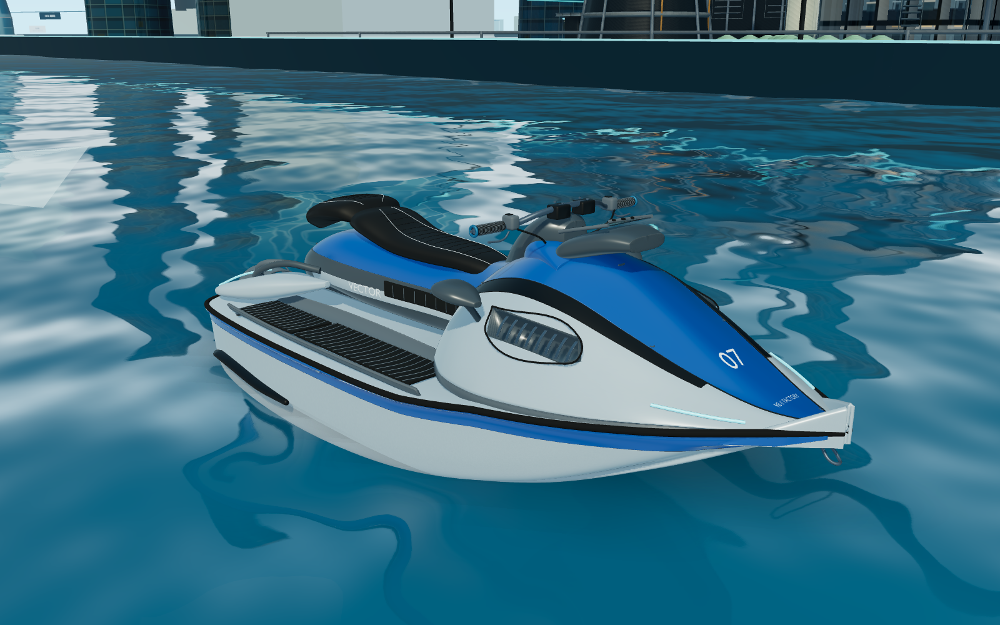

### 2. 快艇右后45度近景

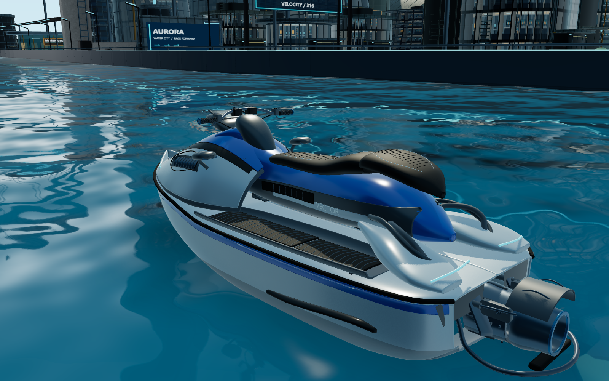

### 3. 快艇侧面近景

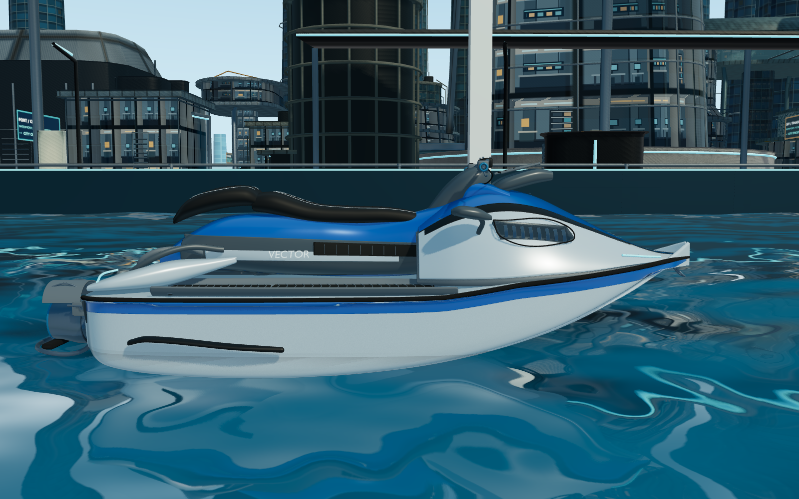

### 4. 驾驶控制区近景

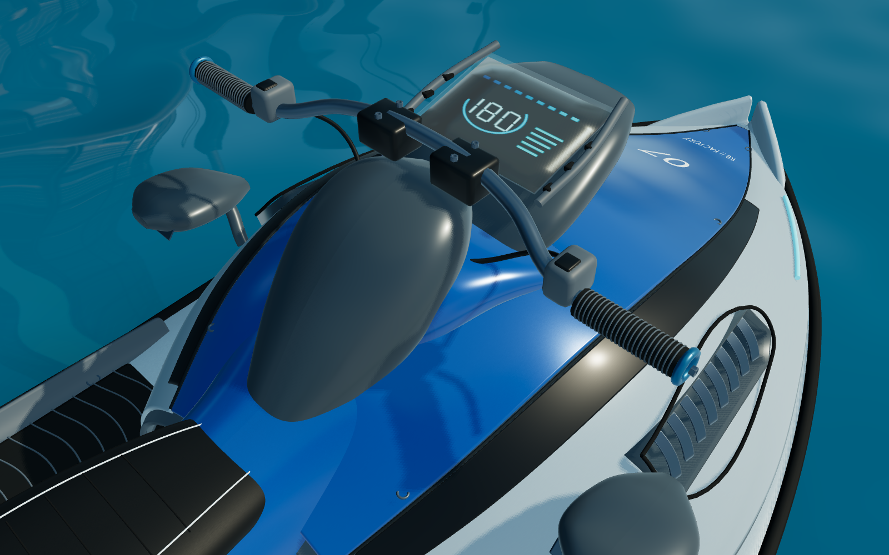

### 5. 尾部推进区近景

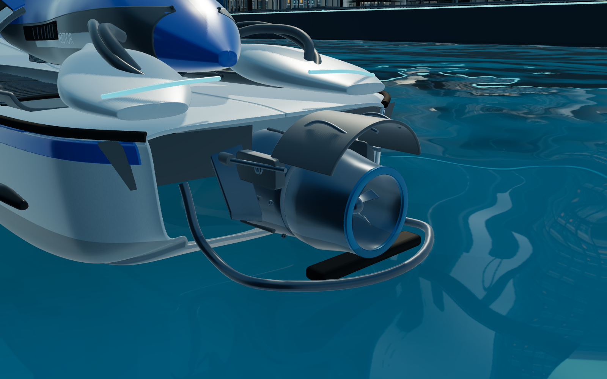

### 6. 车手正面近景

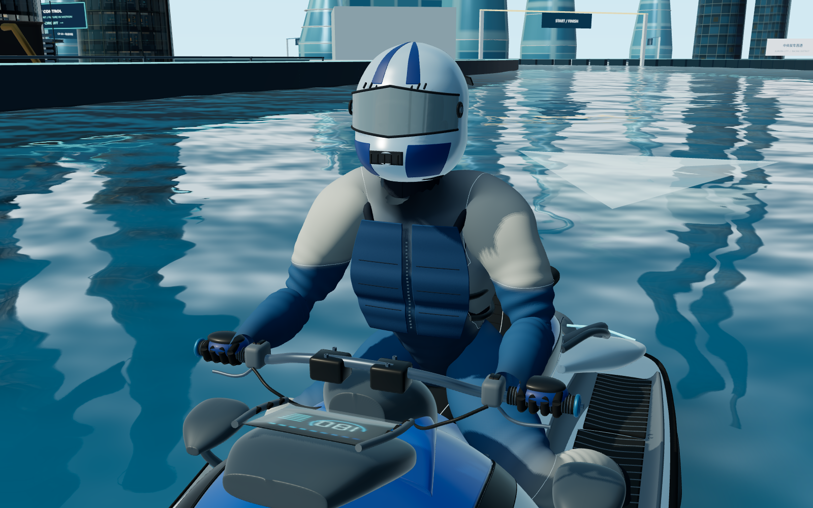

### 7. 车手侧面近景

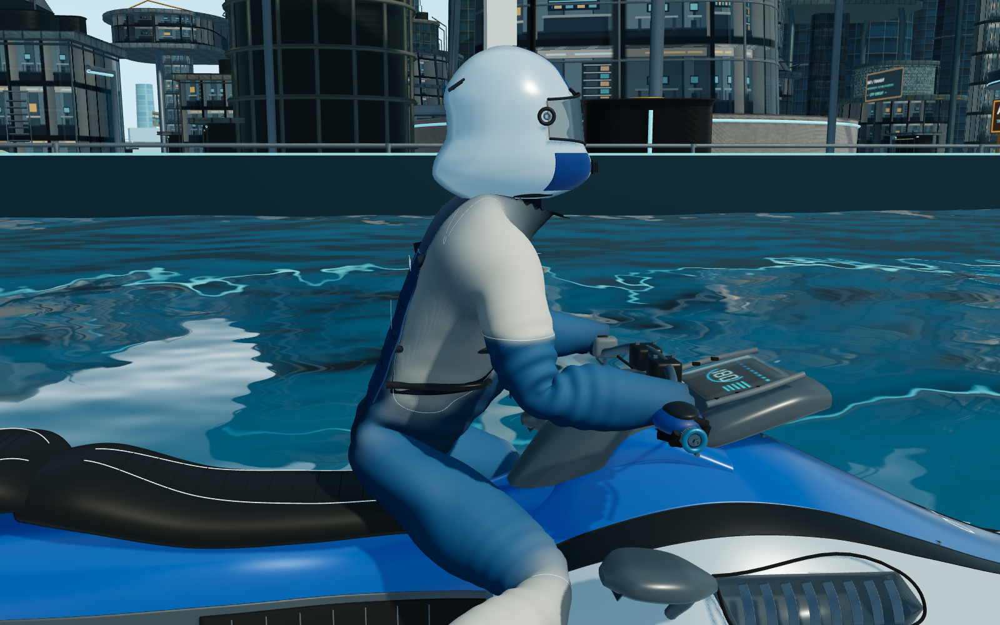

### 8. 车手骑乘快艇近景

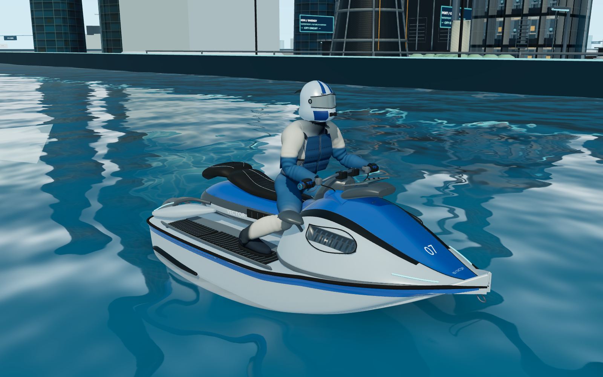

### 9. 正常第三人称驾驶

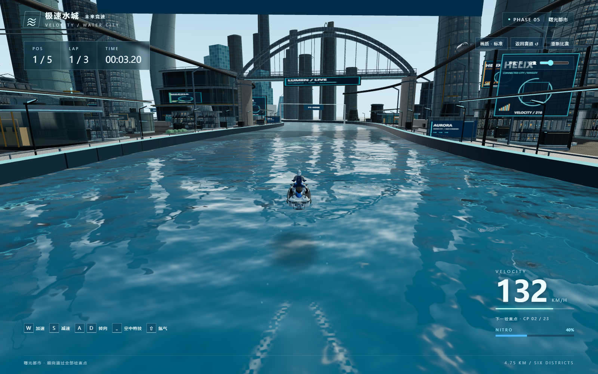

### 10. 水面近景

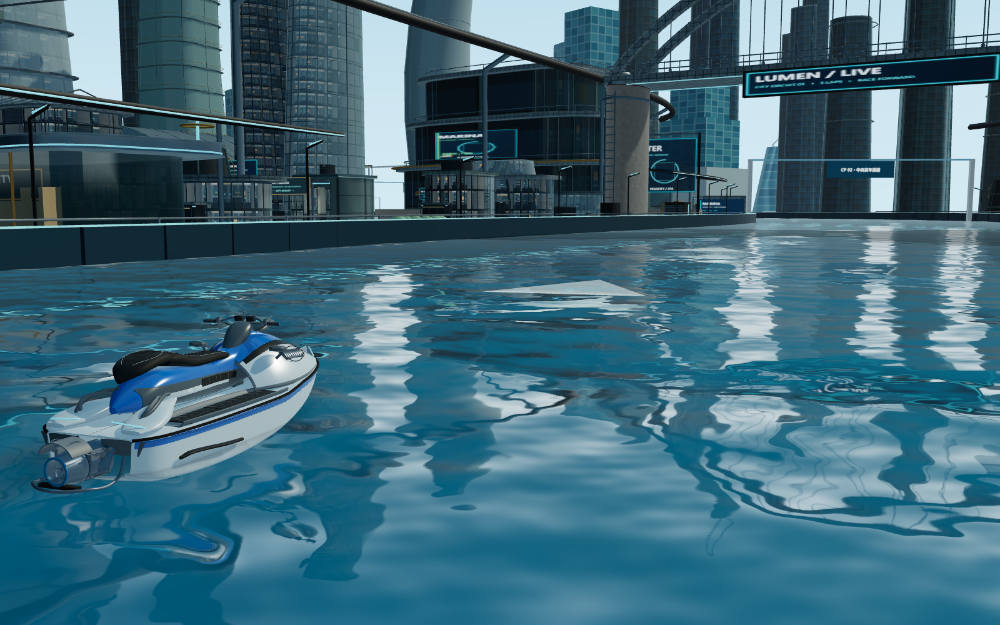

### 11. 斜视角水面

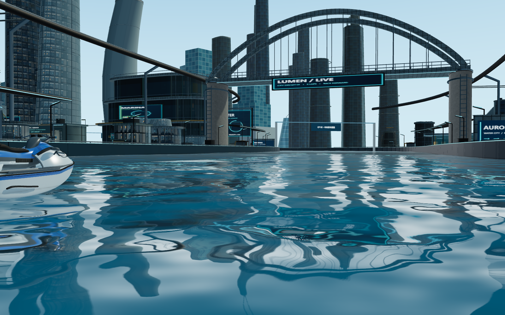

### 12. 高速水面与尾浪

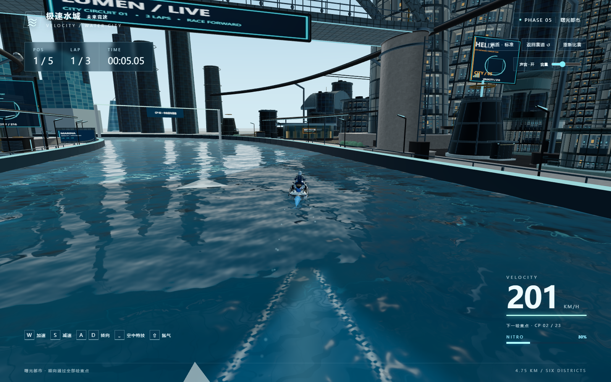

## 同位置同视角对比

比较图的相机、赛道坐标、38°FOV和时间参数相同，参数见before/after-shots.json。下方左列来自本轮修改之前，不是更早阶段的占位版本。

| 对象 | 修改前 | 当前 |
|---|---|---|
| 快艇主形 | 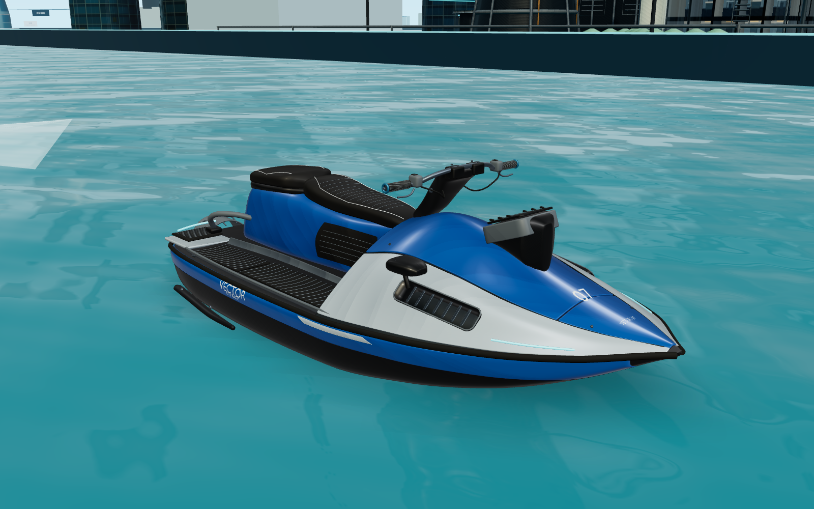 |  |
| 骑乘整体 | 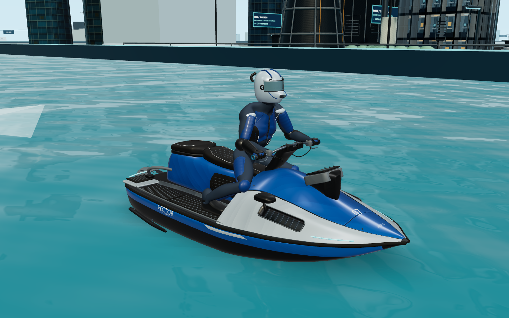 |  |
| 车手近景 | 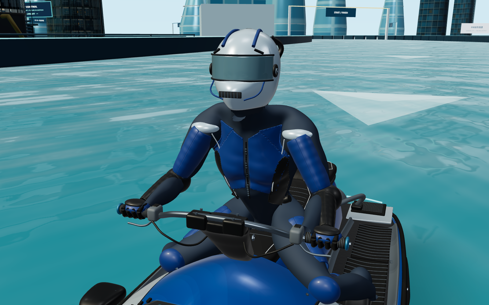 |  |
| 水面 | 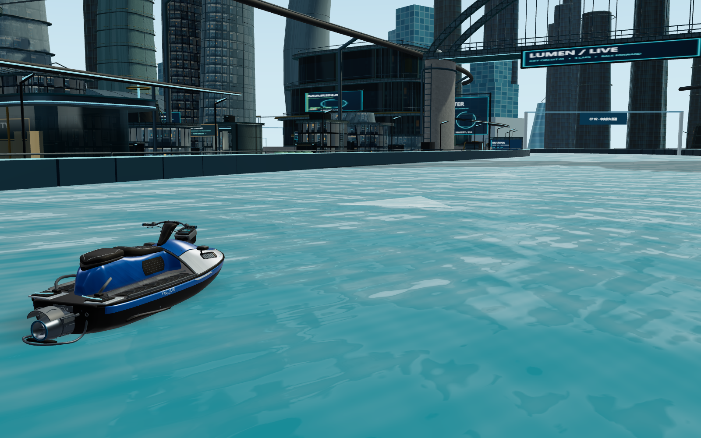 |  |

补充：[转弯近景](hero-water-rebuild/turning-close.png)、[腾空近景](hero-water-rebuild/airborne-close.png)、[特技近景](hero-water-rebuild/air-trick-close.png)、[落水截图](hero-water-rebuild/landing.png)。

## 文件、来源与实际规格

| 资产 | 制作方式 / 源文件 | 当前几何与贴图 |
|---|---|---|
| 玩家PWC | Blender原创深度重构；`assets/racecraft/source/hero-pwc-r8.blend`，330部件+45设计曲面 | 3,419,130三角面；GLB 102,633,960 B；19张PNG 63,266,564 B |
| 玩家车手 | 已保留的[Blender官方CC0人体基础](https://www.blender.org/download/demo-files/#assets)+原创服装、装备与坐姿适配；`assets/racecraft/source/hero-rider-r3.blend` | 1,437,700三角面；GLB 67,519,076 B；19张PNG 67,008,554 B；43骨骼 |
| 运行文件 | `public/models/watercraft.glb`、`rider.glb`以及`pwc-r8/textures/`、`rider-r3/textures/` | 合计286.5 MiB（不含城市、AI资产） |

纹理为现有原创2048² BaseColor/Normal/ORM，仪表为1024²；本轮没有取得新的外部位图。微结构/AO仍属程序化与解析近似，不是照片扫描或新烘焙的高模AO。GLB相对URL可由Vite直接打包，完整保留贴图目录即可。

免费候选的官方Sketchfab下载接口本轮实际返回401，未下载也未使用；不能声称已经核验包内许可证/模型质量。已有Blender人体基础的CC0来源记录、原始许可文本继续保留。新增快艇/服装/纹理适配及代码是项目原创；没有购买素材、提取受版权保护游戏资产或引入未知来源模型。[完整来源与许可证记录](../assets/racecraft/README.md)。

## 主要修改文件

- 资产与生成：`scripts/art/rebuild-hero-pwc.py`、`rebuild-hero-rider.py`、`asset_packaging.py`、`scripts/build-racecraft.mjs`；两个新Blender源文件、两个运行GLB、38张相对路径PNG及manifest。
- 水面：`src/effects/Water.ts`、`WaterSurface.ts`、`WaterNormals.ts`；`Wake.ts`增加向水面交接已有尾浪池的视觉入口。
- 主角光照：`src/player/HeroLighting.ts`；`src/core/Game.ts`仅连接视觉模块与资源释放。
- 验证：`tests/hero-water-rebuild.test.ts`、旧资产测试的安全贴图路径规则、`scripts/qa/hero-water*.mjs/html`。

## 实际验证

- TypeScript：`node node_modules/typescript/bin/tsc --noEmit`通过。
- 自动化：`node node_modules/tsx/dist/cli.mjs --test tests/*.test.ts`，**103/103通过**。新增5项覆盖近景网格、尾浪有界/消退/重置、反射目标释放、主角渲染状态/材质钩子恢复、脚垫不被船壳遮挡、连续服装颜色/贴图/骨骼接口。旧驾驶、碰撞、跳台、AI、特技、氮气、三圈/排名等测试保留。
- 生产构建：`node node_modules/vite/bin/vite.js build`通过；保留Three.js分包大于500KB的构建提示，未将其误报为失败或静默提高阈值。[测试日志](hero-water-rebuild/all-tests.log)、[构建日志](hero-water-rebuild/build.log)。
- 实际Edge浏览器WebGL：W加速、D转弯、Shift冲刺到**216.0 km/h**；合法跳台起飞、Space完成特技、落水后能量由19.1%增至54.1%，只奖励35%。HUD当时排名1 / 5、圈数1 / 3。五名选手资产全部加载，每名车手一个独立骨架，无页面或WebGL着色器错误。[驾驶/跳跃记录](hero-water-rebuild/game-results.json)。
- 实际生产预览5174：模型和38张当前贴图均HTTP200；W/A/S、减速至0 km/h、重新比赛/初始40%能量通过；生产入口没有window.testGame。[生产记录](hero-water-rebuild/production-results.json)。
- 低/标准画质循环后，同一固定机位下标准画质资源计数稳定。重新比赛清空尾浪、喷溅、腾空/特技状态；销毁并重建Game后无着色器重复注入错误。[运行/资源记录](hero-water-rebuild/runtime-results.json)。
- 两个新Blender源文件都实际重新打开，所用图片全部有打包数据或有效相对文件；43骨骼保留；源文件和单个GLB均小于100MiB。[源文件检查](hero-water-rebuild/source-check.json)。
- 短性能采样：RTX4060 Laptop、Edge无头、1600×1000、DPR1、标准画质，实际W驾驶144.2→180.0 km/h的120帧，RAF平均23.71ms、P95 25.10ms。这是单设备短采样，不等于整张地图、长时间或所有桌面设备的FPS承诺；未做同条件旧版性能基准。

可复验：先运行开发服务器，再设置可用的PLAYWRIGHT_MODULE路径或安装可被Node解析的playwright，然后运行`node scripts/qa/hero-water-shots.mjs after`、`node scripts/qa/hero-water-review.mjs`、`node scripts/qa/hero-water-runtime.mjs`；生产预览启动后运行`node scripts/qa/hero-water-production.mjs`。QA入口仅开发时可访问，不进入生产构建。

## 已知限制与用户试玩重点

- 工程和游戏行为已验证，**美术质量仍需看图和试玩验收**。车手是程序辅助制作的真人基础派生服装/装备，没有人工扫描、完整高级服装雕刻或新动捕；近距离仍有程序化面料与装备塑形的局限，不能称为商业级成品角色。
- 快艇已深度重构主要外观，但仍是原创程序辅助工业曲面；部分机械装配为既有R7部件，不是假称整艇所有零件重新制作。仪表180是装饰纹理，不是新增实时仪表玩法。
- 水面反射基于平面、波纹法线与近似体色，没有真实折射深度、实时流体或多层水体模拟。局部主角阴影用于自身，水面接触感仍包含已有简化接触影。
- 主角完整资源约286.5MiB、约4.86百万三角面，符合本轮质量优先方向，但冷启动、内存和低端GPU成本明显较高；没有为手机/LOD主动降级主角质量。AI继续旧低模。
- 本轮没有真人手动跑完整三圈、长时间压力测试或真实手机测试；三圈/排名/结束流程的回归来自现有自动化测试。没有部署。

请重点试玩：第三人称下人体比例与骑姿、船头/侧体/船尾的工业产品感、漆面与织物是否仍显塑料、不同视角的水面反射、170–180km/h尾浪、跳跃/翻转时手脚与艇体关系。本轮到此停止，等待验收。
