# 主快艇高精度重建验收 · VECTOR R7 · 2026-10-16

本轮基于 `b429659`（标签 `pwc-rebuild-baseline`）重建玩家快艇。**旧快艇的主体网格全部替换**；仅沿用上一轮原创PBR基底、仪表图和座椅/握把/脚踏/喷射挂点。车手、AI模型和 `src` 下的游戏代码均未修改。

## 为什么重建

旧版虽然已有约69万三角面，但船头长尖、侧壳像分离的鼓包，座椅/船身缺少支承关系；尾喷是环架结构。这些属于主形、分件和装配关系问题，继续细分或加灯带不能解决。本轮换成较短宽的前甲板、连贯的中央座椅基座、下沉脚槽和完整铸造喷泵。

设计参考仅限真实PWC的功能关系，例如分体竞速座椅、脚槽排水、转向控制区与喷射推进：[Yamaha GP SVHO官方结构介绍](https://www.yamahawaverunners.com/waverunner/series/performance/GP-SVHO/)、[Sea-Doo RXP-X官方车型介绍](https://sea-doo.brp.com/gb/en/models/personal-watercrafts/performance/rxp-x.html/trim/rxp-x-325)。VECTOR R7为本项目原创外形和标识，没有导入这些厂商的网格、图片或品牌标志。

## 七组指定视角

全部来自实际游戏的WebGL渲染，没有用宣传渲染替代游戏画面。近景在暂停状态下移动QA相机、隐藏HUD，必要时隐藏车手；未加额外补光、滤镜、运动模糊或后期修图。尺寸1600×1000。正侧面采用正交相机，其余近景38°FOV；生产跟随镜头保持原样。

### 1. 左前45度近景

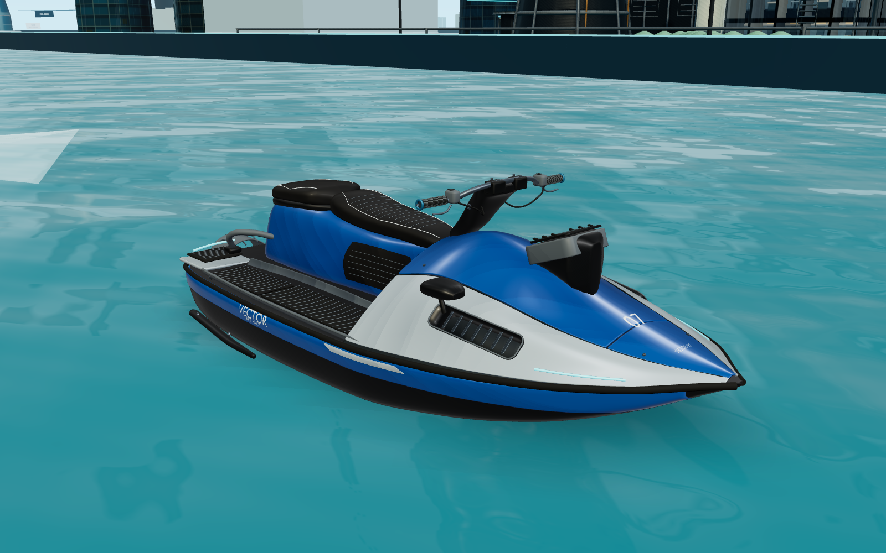

### 2. 右后45度近景

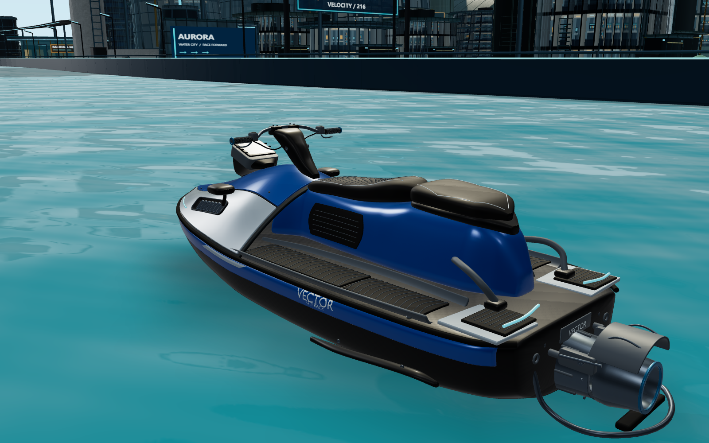

### 3. 正侧面

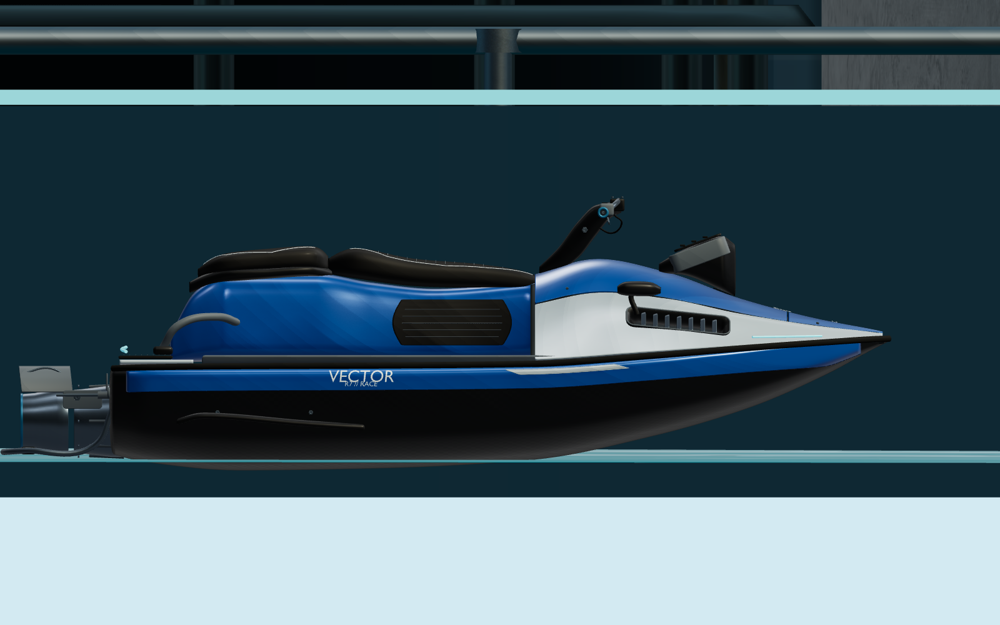

### 4. 尾部推进区域

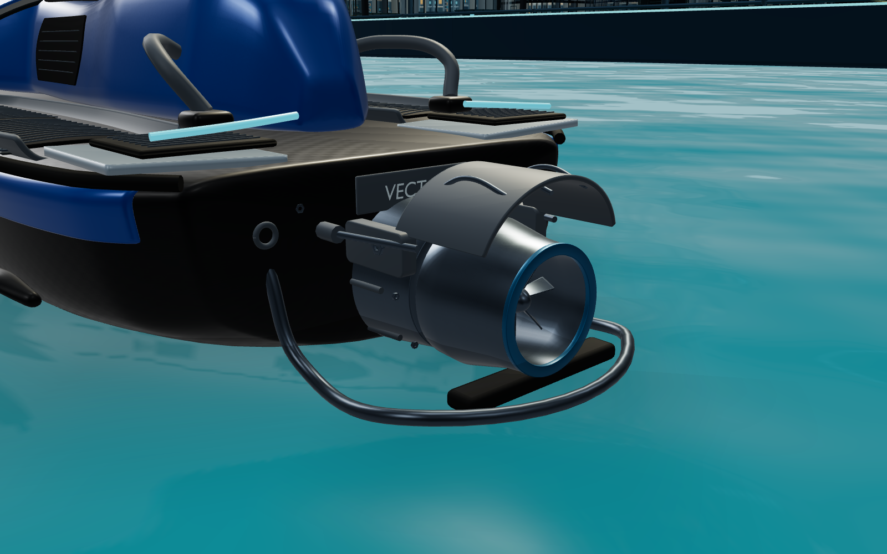

### 5. 驾驶控制区域

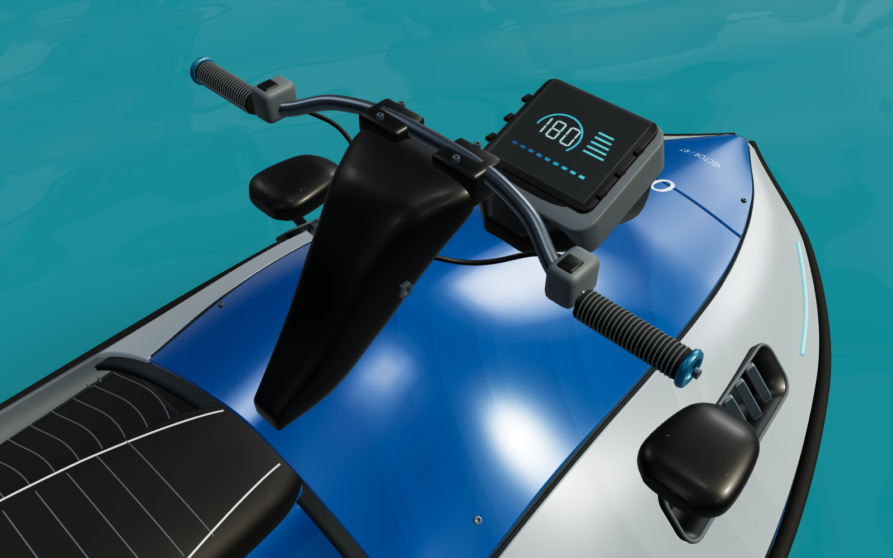

### 6. 车手骑乘近景

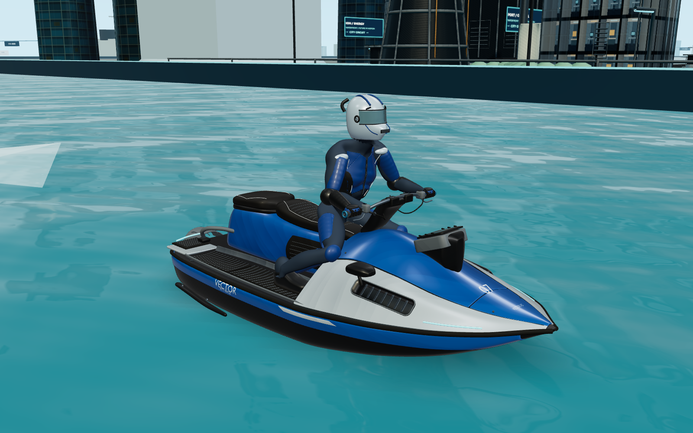

### 7. 第三人称正常驾驶

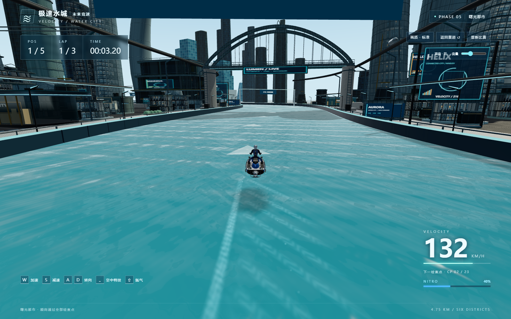

## 与上一版同位置、同视角比较

两列使用相同赛道坐标、时间、相机位置与38°FOV，均为实际修改前后截图。具体参数保存在 `pwc-r7/before-shots.json`、`after-shots.json`；下方侧面比较使用相同的透视相机，与上方单独的正交侧面不同。

| 上一版 | VECTOR R7 |
|---|---|
| 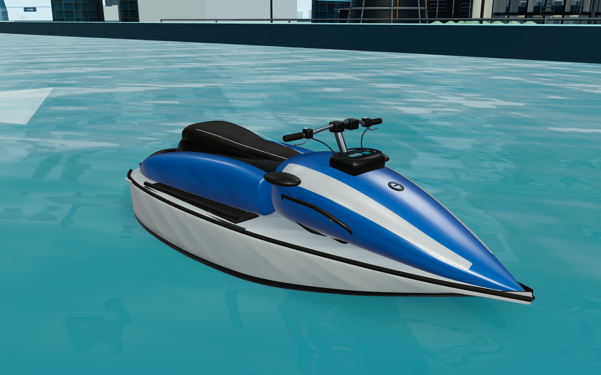 |  |
| 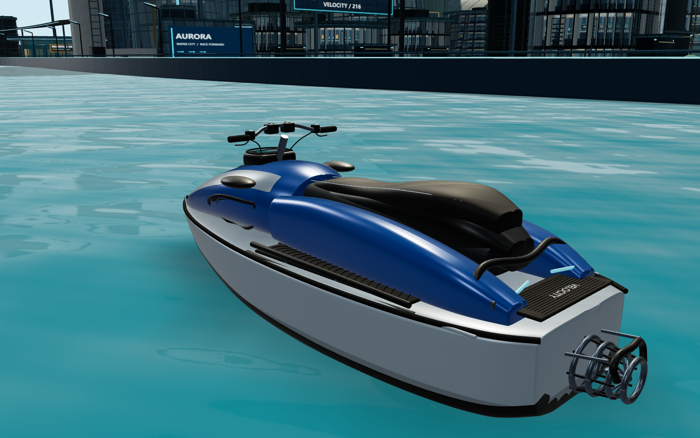 |  |
| 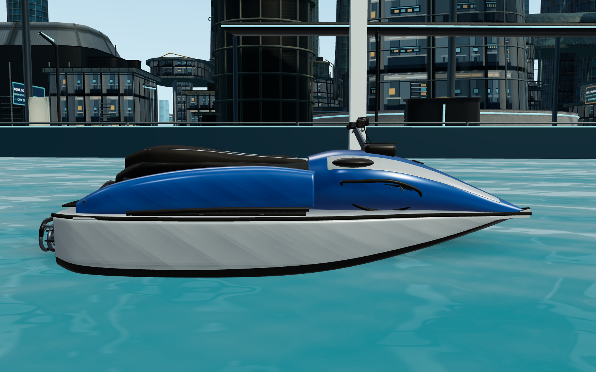 | 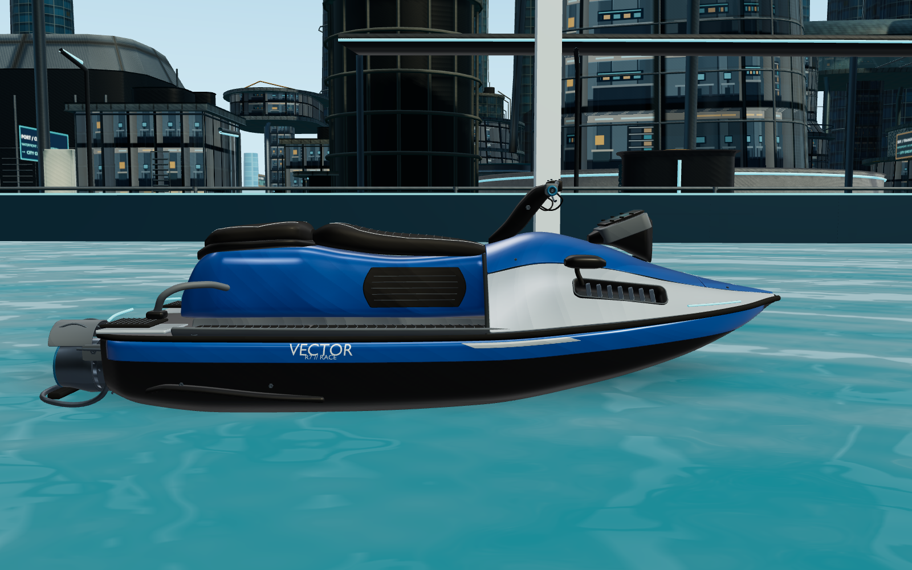 |
| 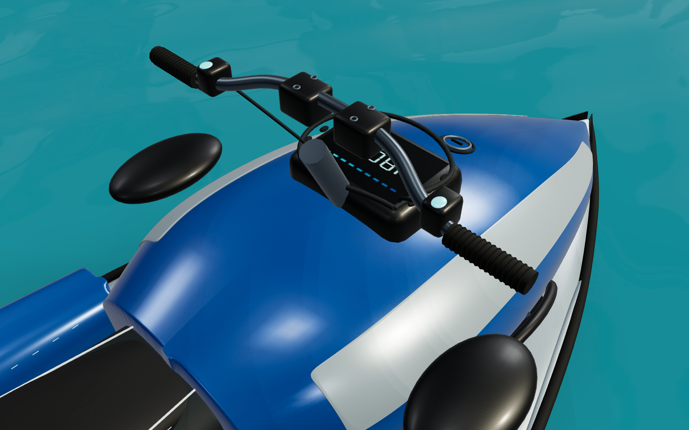 |  |

## 重建范围与曲面处理

| 区域 | 实际重建内容 |
|---|---|
| 船头/上盖 | 新的纵向截面与张力曲面，较宽的肩部、抬升船头、独立服务上盖/前端盖/银色肩板；上盖分件之间有间隙、壳厚和密封边 |
| 主船体 | 新阶梯船底与折角轮廓、连续防擦包边、贴合真实侧面的蓝色裙板；不再以单一白色大侧壁表达艇身 |
| 进气 | 两侧真正Boolean开孔，贯穿肩板和承托层；独立内衬、下沉腔体、密封唇与14片有厚度的导流片 |
| 骑乘区 | 连贯的座椅基座、后座承托壳、两级座垫、贴合座面的缝边/牵引压纹与侧面膝部防滑垫；去掉旧版分离浮体式侧壳 |
| 脚槽 | 有凹位和边沿的成型脚槽，前后分区防滑垫、细密人字纹、排水口/边框；原脚踏接触点保持不变 |
| 控制区 | 成型转向桥/护罩、可见轴段、倾角枢轴、夹具内六角螺钉、细纹握把/端部配重、扳机、开关与完整连接的控制线；独立倾斜仪表台、承台、边框、透明盖与按键 |
| 尾部 | 有壁厚和贯通内孔的泵壳/转向喷嘴、出口磨耗圈、导叶/轮毂、实心反推罩、枢轴支架、执行缸/推杆/控制线、法兰螺栓和排水塞；还有折叠登艇踏步、后甲板防滑垫、抓手与灯组 |
| 工业标识 | 原创VECTOR/R7标识、船头编号和尾部铭牌，贴合曲面，正反朝向分别处理；没有借用现实厂商品牌 |

建模在Blender 4.5.9中完成，使用原创截面网格、形状保持的三次插值、曲面分区、细分、壳厚、倒角、真实布尔切口、曲面贴合和精密分件。关键主形使用共享曲面参数保持衔接；侧面饰板、膝垫与贴花按最终曲面重新投射，避免初版出现的穿插。贴花网格细分后再贴合，修复长字母三角面穿入凸曲面的缺字现象。

新源场景保留351个分件和11个隐藏的设计控制网格，按功能分集合。控制网格是切口/壳厚/细分前的设计快照，供继续编辑；不是与已导出部件实时联动的CAD参数树。真实运行资产不包含这些隐藏控制网格。

## 材质与文件

沿用上一轮原创2048²BaseColor/Normal/ORM表面：主漆、珍珠银、碳纤维、拉丝金属、橡胶、座垫皮革；调整主漆与银面的清漆权重，增加工程塑料、蓝色阳极件与透明仪表盖的材质分区。不同粗糙度、金属度和法线响应继续保留，没有只用纯色替代整艘艇。仪表仍为原1024²装饰图，实时速度以原HUD为准。

| 文件 | 作用 |
|---|---|
| `scripts/art/build-pwc-r7.py` | 本轮原创重建、分件、布尔、贴合、源文件和运行GLB导出 |
| `assets/racecraft/source/pwc-r7.blend` | 可编辑成品分件、设计网格、挂点，纹理使用仓库内相对路径 |
| `public/models/watercraft.glb` | 实际玩家快艇几何、材质及挂点 |
| `public/models/pwc-r7/textures/` | 19张同分辨率PNG：18张2K PBR图加1张1K仪表图 |
| `assets/racecraft/textures/hero/` | 继续保留的原创贴图源文件；没有修改车手贴图 |
| `public/models/manifest.json` | 面数、资源体量、分件类别与PNG依赖清单 |
| `tests/pwc-r7.test.ts` | 喷嘴贯通孔、实心反推罩、握把/脚踏接触面回归 |
| `tests/racecraft-visuals.test.ts` | 更新可移植图像检查：同时支持旧嵌入图和新相对PNG依赖 |

本轮主快艇约**220.81万三角面**，上一版约68.91万；这只是资源成本记录，不作为美术质量达标依据。GLB约63.8MiB，PNG依赖约60.3MiB，快艇合计约124.1MiB。为避免单文件过大，PNG按glTF标准使用相对路径分文件保存，像素数据未缩放/降质，网格未减面；没有新增加载器、物理库或性能回退系统。发布模型时必须带上整个PNG目录。

`npm run assets:build`现在只重建VECTOR R7快艇；不覆盖车手/AI模型。需要Blender4.5+，可通过`BLENDER_PATH`指定。上一轮快艇/车手生成器保留为历史工具，不再是默认重建入口。

## 免费资源筛选与版权

先检索了免费资源，再使用原创建模作为本轮方案。候选记录如下，**未取得文件的条目没有被拿来改模或宣称已验证模型质量**。

| 候选 | 作者/许可标注 | 实际核验与选择 |
|---|---|---|
| [Personal watercraft](https://www.innerscene.com/tools/library/3d-parts/personal-watercraft-1956f692) | Innerscene，CC0 | 原GLB已在上一轮下载并保留许可；其旧主体比例不适合继续补修，本轮主体网格没有复用 |
| [Jetski](https://sketchfab.com/3d-models/jetski-15e79c65f67a468592cdc2ac1f5b389b) | appsnation，页面标注CC BY、Blender制作/约120万面 | 页面访问403，正式下载API返回401要求认证；未取得实际文件，格式/拓扑未核验，未采用 |
| [Jetski collection](https://sketchfab.com/3d-models/jetski-collection-d261f758b40c45fdb03ddb57fe89a59e) | Jungle Jim，页面标注CC BY | 正式下载API返回401；未取得实际文件，未采用 |

下载状态原始记录见 [download-check.json](pwc-r7/download-check.json)。本轮交付的主体、侧壳、座椅、脚槽、控制区和尾部机械均为本项目原创Blender几何；原有PBR/仪表图也是项目原创。没有新增需要署名的外部资产，没有购买素材或使用商业游戏提取资源。既有CC0基础来源和Blender车手署名记录继续保留，详见 [资产来源说明](../assets/racecraft/README.md)。原创部分的整体公开许可证仍由项目所有者决定。

## 实际验证

- TypeScript类型检查：通过。
- 自动化测试：**98/98通过**。新增2项针对性检查实际喷嘴中心孔不会被面封住、反推罩几何存在、两只握把覆盖原挂点、足底与真实防滑垫面的间隙小于12mm；原驾驶、碰撞、跳台/AI、检查点、三圈/排名和30/60/120渲染调度回归继续通过。[测试输出](pwc-r7/tests.txt)
- 生产构建通过。原Three.js分包大于500kB的提示仍存在，没有把提示隐藏。[构建输出](pwc-r7/production-build.txt)
- Edge实际WebGL输入测试完成W加速、D转弯、Shift氮气、跳台腾空、空格特技与落水。采样氮气速度215.52km/h，落水后能量22.4%→57.4%，恰好+35%，没有改参数或直接写成功状态。跳台测试只将艇放到原跳台前18米，由实际游戏循环起跳和落地。[运行记录](pwc-r7/game-results.json)
- 生产预览加载新GLB和19张PNG均HTTP200；W/A/S、刹车归零、重新开始恢复40%能量/倒计时通过，无页面或模型/着色器错误，生产页没有暴露QA Game实例。[生产页记录](pwc-r7/production-results.json)
- `/water-city/`子路径预览加载全部相对纹理并可驾驶，未请求错误的根路径资源。该测试是本地部署路径兼容验证，**没有部署GitHub Pages**。[子路径记录](pwc-r7/nested-path-results.json)
- Blender重新打开源文件，351分件、11设计网格、19张使用中的图像依赖均存在。[源文件检查](pwc-r7/source-check.json)
- `src`全部无diff；玩家车手、AI车手和AI快艇三个GLB逐文件SHA256与保护点一致。[保护检查](pwc-r7/protected-verification.json)

兼容性动作截图：

| 转向 | 氮气 | 腾空 |
|---|---|---|
| 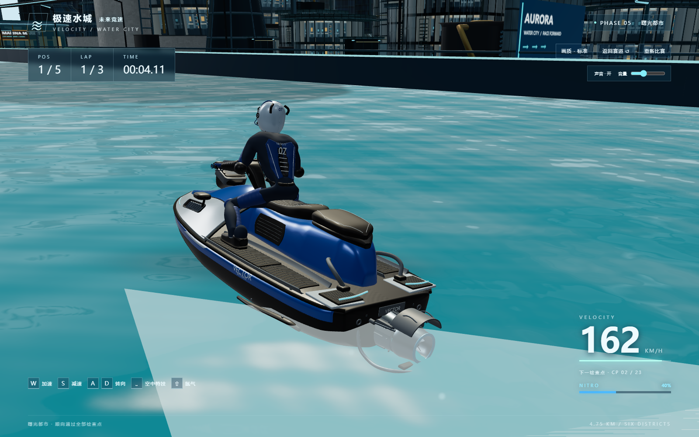 | 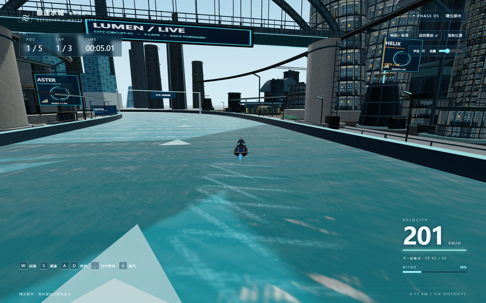 | 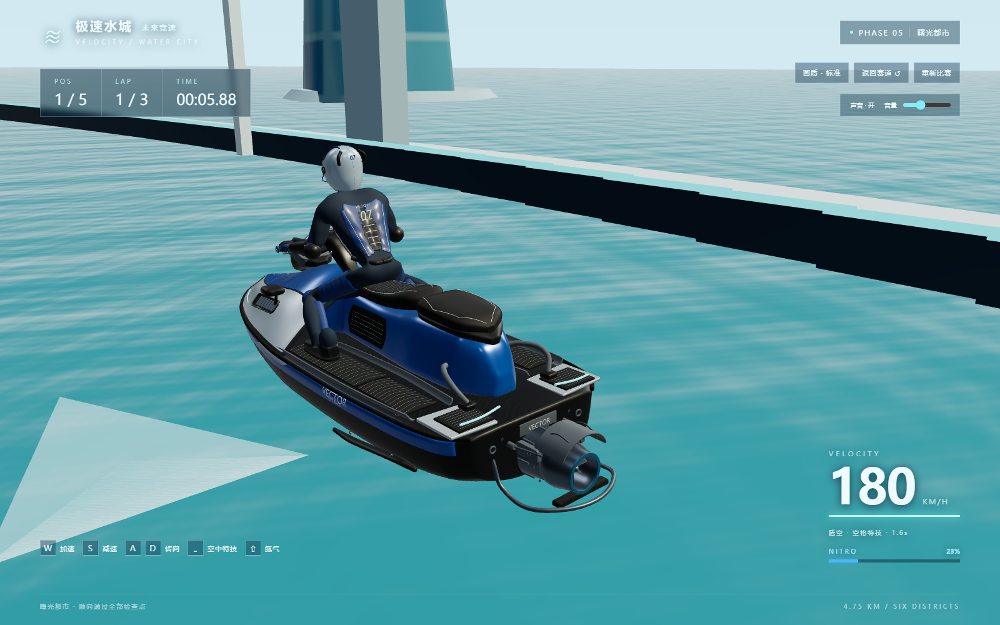 |

## 验收边界

最大的可见变化是**完整重做主形和工业装配**：宽肩船头、连贯骑乘基座与脚槽、独立控制总成、真实开孔进气和实心喷泵取代旧环架。此版本应按上方近景和原跟随镜头截图直接评估，而不是按分件/面数认定达标。

这是原创可玩美术资产，不是厂家工程CAD或实物扫描。仪表为静态装饰图；机械组件为视觉装配，不提供新的可操作功能。局部接缝、镜壳和细小零件仍可能需要依据用户近距离试玩继续打磨，不能承诺所有极端姿态绝无穿插。

本轮按要求没有减面、做新LOD或优先手机优化；资源成本明显上升，未做低端显卡/真机/长期帧率验收。原镜头较远，常规第三人称画面中微小纹理受像素占比限制。浏览器操作由自动化真实按键完成并目视检查截图，没有人工完整跑三圈；三圈与多艇物理由现有自动化回归验证。

本轮停止在VECTOR R7版本，等待用户对模型质量验收；不扩建场景、不修改水面/车手/玩法、不部署。
