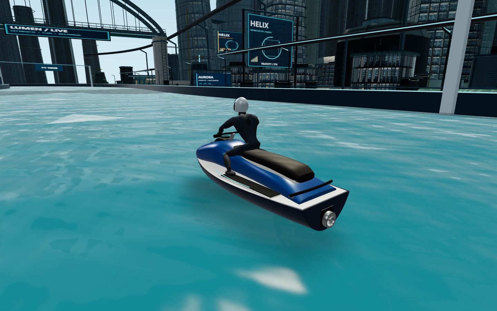
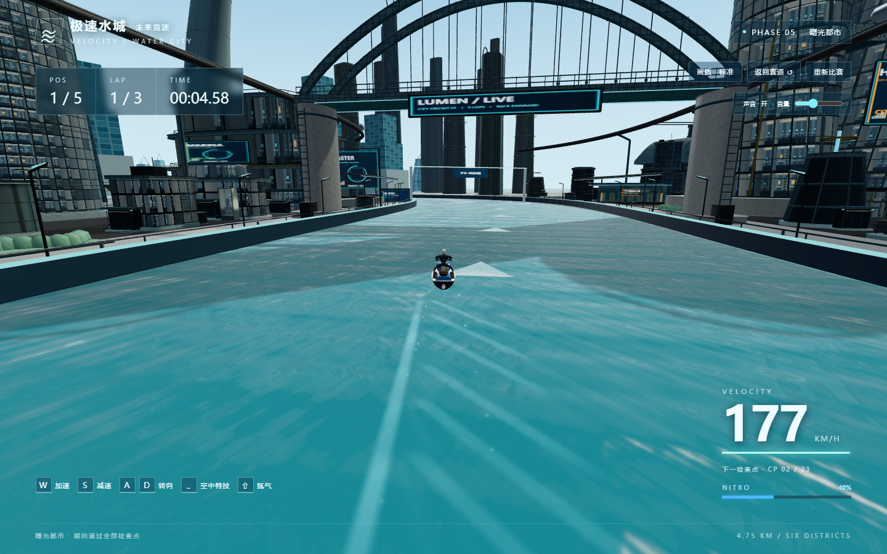

# 车手、快艇与水面验收 · 2026-10-15

开始保护标签：`craft-water-baseline`（9106756）。本轮只修改玩家/AI的视觉模型、视觉动画接入、模型生成/加载和水面/尾浪。赛道、环境布局、核心驾驶、速度配置、AI、跳台物理、检查点、氮气规则、特技规则、碰撞、比赛/计时/排名、输入和摄像机代码均未变。最终审阅标签：`craft-water-review`。

主要实现提交为`b4f3ee5`，后续补正仪表盘UV并重新导出。修改代码包括`src/player/{Watercraft,Rider,AnatomicalRider,VisualAssets}.ts`、`src/effects/{Water,WaterNormals,Wake,BoosterJet}.ts`、资产构建脚本、`tests/racecraft-visuals.test.ts`及GLB测试辅助读取器。没有通过改相机远近或提高速度掩盖模型问题。

## 实际资源策略与建模

已实际下载、解析并使用两个免费资源，未购买素材：

| 资源 | 来源与许可 | 改动 |
|---|---|---|
| Personal watercraft | [Innerscene模型页](https://www.innerscene.com/tools/library/3d-parts/personal-watercraft-1956f692)，原创无品牌模型，CC0；[条款](https://www.innerscene.com/tools/library/terms)明确允许原文件和衍生文件再分发 | Blender中重定向/统一比例、漆面、金属/橡胶/仪表、纹理缩放、灯带、定位点、按材质合并与两档LOD |
| Human Base Meshes v1.4.1，真实男性身体 | [Blender官方资源页](https://www.blender.org/download/demo-files/#assets)，官方与包内README标记CC0 | 采用真实人体拓扑，原创建立15骨骼骑姿、热权重蒙皮、服装材质、头盔面罩、护具、手套/靴、缝线及两档LOD |

完整来源、实际下载链接和SHA256见 [资产说明](../assets/racecraft/README.md)。包内另有提及Rain Rig CC BY的通用License文本；未用该Rig，仍保留原说明及Blender Foundation署名。没有直接取用《激流快艇2》资产。不是把免费模型重新标成原创作品。

快艇连续船壳、独立弧形座椅、脚踏槽、驾驶柱/把手、仪表舱、后扶手和单泵喷结构来自真实PWC方向的基础资产。去掉此前双发飞船式尾喷外形，保留克制的蓝银配色及嵌入灯条。基础艇约3.375m，视觉放大1.18倍至约3.98m；现有碰撞胶囊参数未改。因此新艇轮廓比旧约4.7m细长占位模型更短，碰撞仍为原有简化体，不是逐面精确碰撞。

角色使用连续人体网格与骨骼，不再用独立圆柱当四肢。肩、肘、髋、膝保持人体结构；双臂做视觉两骨骼IK，握把位置来自艇身定位点。前倾、转向侧倾及落水缓冲沿用原平滑输入；特技仍旋转整套视觉组，骨骼不会改变物理驾驶方向。头盔是原创成形外壳、独立前面罩、下颌保护与密封结构；竞速服仍是简化贴身服装，不能宣称有专业服装雕刻或布料模拟。

玩家与四艘AI都使用同一套新外观。玩家标准画质用高精度版，AI始终使用同源低精度版；低画质玩家也降一级。每位车手有独立骨骼，同一角色的6个材质子网格共用一个Skeleton。切换模型会释放旧骨骼纹理，避免质量切换累积。

## 模型、材质预算与编辑文件

| 运行文件 | 本轮三角面 | 旧三角面 | 本轮字节 | 材质绘制组 |
|---|---:|---:|---:|---:|
| `public/models/watercraft.glb` | 51,473 | 17,224 | 1,935,900 | 10 |
| `public/models/watercraft-low.glb` | 21,610 | 9,592 | 785,972 | 10 |
| `public/models/rider.glb` | 21,586 | 11,968 | 894,172 | 6 |
| `public/models/rider-low.glb` | 9,929 | 5,784 | 470,292 | 6 |

数据来自实际生成清单 `public/models/manifest.json`，运行时抽查总面数一致；氮气视觉另有两个简单喷流网格32三角面，故玩家视觉总计73,091、每艘AI31,571。高精度细节增加，但人物从19个分件绘制降至6个材质组，一艘艇含喷流共18组，原来26组。

艇身保留8张CC0 BaseColor纹理，高档512²、低档256²；另有原创256²数字仪表。原料区分为蓝色带清漆漆面、银白复合壳、金属支架/泵、深色橡胶脚垫、黑色座椅和深色仪表罩；金属度、粗糙度、清漆各自设置，并非所有表面使用一套高金属度。车手有2张原创256²织物Normal/Roughness图，头盔与面罩另用PBR参数。没有宣称艇身所有表面都有全套Normal/AO贴图。

可编辑文件：

- `assets/racecraft/source/pwc-cc0.glb`：实际免费原始艇。
- `assets/racecraft/source/human-base-cc0.blend`：从官方包抽取的真实人体基础网格。
- `assets/racecraft/source/racecraft.blend`：艇身编辑场景，保留原有零件与新增仪表/灯带/定位点。
- `assets/racecraft/source/racer.blend`：角色、装备、UV、材质和15骨骼。
- `scripts/art/build-racecraft.py`：Blender改模/导出；`scripts/build-racecraft.mjs`与原`build-models.mjs`入口负责寻找Blender，避免旧占位生成器覆盖新资产。

重建用`npm run assets:build`，需Blender 4.5+；普通运行与生产构建不需要Blender。默认脚本从原始基础文件生成；手工改派生`.blend`需自行导出或同步生成脚本。运行GLB全部内嵌图片，继续使用Vite相对资源路径。

## 水面与速度反馈

- 原创256²周期法线谱，合成多方向毛细波；开启mipmap与距离衰减，近处两层不同速度/方向滚动，远处减少微细波，低画质只采样一层。
- 保留原0.11m以内的轻微视觉起伏和水位关系，增加交叉宽波颜色层次、清爽蓝绿水色、Schlick Fresnel和日光细高光。
- 标准画质一次生成样板区128²六面静态反射，隐藏五艘艇后采样，避免静态艇影留在水中；行驶期间不重绘反射。反射仅在样板区附近渐变混合，不当作整张地图正确的平面镜像。低画质不采样城市反射；从标准切到低画质时允许保留已分配目标以便复用。
- 现有尾浪池容量200/低72、寿命1.45s、五艇共用逻辑保持；调整V形泡沫为断续细纹，增强中线扰动与高速可见度。喷流改为跟随新泵喷定位点，脉动只改变火焰长度，不移动喷口。
- 转弯、起跳、落水和碰撞水花系统保持原逻辑。没有新增流体模拟、SSR、每帧反射、多帧累积或运动模糊。

## 七类验收截图

均来自实际Edge WebGL画面1440×900，没有后期替换或概念图。近景模型对比使用相同艇位/朝向与相机参数；具体相机见 `racecraft-water/{before,after}-shots.json`。模型近景会隐藏其他艇以避免遮挡，驾驶/跳台截图是运行中的实际按键画面。

| 必需画面 | 截图 |
|---|---|
| 快艇近景 | [旧版](racecraft-water/before-boat.png) / [新版](racecraft-water/after-boat.png)；[艇尾泵喷](racecraft-water/after-rear.png) |
| 车手近景 | [旧版](racecraft-water/before-rider.png) / [新版](racecraft-water/after-rider.png) |
| 车手骑乘 | [旧版](racecraft-water/before-mounted.png) / [新版](racecraft-water/after-mounted.png) |
| 正常驾驶 | [实际驾驶视角](racecraft-water/normal-driving.png) |
| 水面近景 | [旧版](racecraft-water/before-water.png) / [新版](racecraft-water/after-water.png) |
| 高速水面/尾浪 | [约177km/h](racecraft-water/highspeed-wake.png) / [氮气冲刺](racecraft-water/nitro-wake.png) |
| AI艇与车手 | [AI近景及其他选手](racecraft-water/ai-racer.png) |

补充：[实际跳台特技](racecraft-water/air-trick.png)、[落水恢复](racecraft-water/landing.png)。AI截图保留当时特技提示浮层，模型和艇身仍可辨认；未用静态假动画替代比赛系统。

## 实际验证

1. TypeScript检查通过；自动化94/94通过，0跳过；生产构建通过。保留Three.js约591kB压缩前chunk的体积提示，非编译错误。完整日志见`racecraft-water/tests.txt`和`build.txt`。
2. 新增4项：内嵌贴图/艇身定位点、骨骼克隆隔离与不同前倾/侧倾/特技朝向下握把误差、水面法线有界/单位化/确定性、喷流脉动时喷口稳定。原GLB测试继续检查曲面、有限坐标、视觉边界和低LOD减面。
3. 浏览器实际W驾驶超过174km/h，Shift达到215.52km/h，能量从40%消耗至24.23%；不是另设速度参数。
4. QA入口仅把艇放到原跳台前18m，随后由真实游戏循环与W输入完成起跳；空格触发原特技，实际落水后显示成功、能量从24.23%到59.23%，恰好+35%。没有直接写入“已完成”状态来制造通过。
5. 五艇均加载新GLB、每位独立Skeleton、无模型加载或着色器控制台错误。AI实际比赛/跳台/奖励/三圈回归由原自动化覆盖，本轮没有人工在浏览器完整跑三圈。
6. 正式生产页模型HTTP200，W/A/S、刹车归零和重新开始恢复40%氮气/倒计时通过；无测试对象暴露。844×390触控模拟默认低画质并显示按钮，不代表手机真机验证。

## 性能：实际逐帧绘制

测试机RTX4060 Laptop、Windows、Edge无头1440×900。固定五艇同屏，物理暂停但每帧实际更新车手、波纹并渲染，预热2.5s、采样6s；接近240Hz上限，不能外推为所有设备性能承诺。

| 五艇同镜头 | 原帧率 | 新帧率 | 原/新P95 | 原/新调用 | 原/新三角面 |
|---|---:|---:|---|---|---|
| 标准 | 239.7 | 238.2 | 4.3/4.3ms | 248/208 | 566,003/674,522 |
| 低画质 | 239.3 | 240.0 | 4.3/4.3ms | 386/346 | 363,713/444,528 |

短样本均没有超过50ms帧。面数与纹理成本上升，材质批处理抵消了部分成本，不能称升级没有GPU开销；高档纹理计数104→133。低档调用多于高档来自既有城市材质批处理与实例化策略差异，不表示低档多边形更多。

独立资源测试在每次质量切换后真实绘制12帧，并等待玩家对应GLB完成：预热后标准464几何/139纹理，低448/111，连续6次切换后回到标准仍为464/139，没有持续增长。计数不是显存字节数。新骨骼未共用给其他选手，替换时旧骨骼纹理释放；场景几何、纹理缓存仍按现有方式复用。

原始记录：`performance.json`、`render-memory.json`、`game-results.json`、`production-results.json`、`mobile-results.json`均在`racecraft-water/`。

## 限制与需试玩确认

新模型明显改变了轮廓与人体基础，但服装折皱、手指握姿、脚踝连接、头盔细节和近距离贴图仍是简化实现，尚不能宣称达到《激流快艇2》成品美术质量。请重点检查转向/加速时的肩肘姿态、特技与落地时是否有可见穿模，以及高速水面反光是否偏亮或闪烁。

水面是着色器与局部静态环境反射，不反射动态快艇，不提供真实折射/水深/岸边流体；初次六面采样可能带来一次加载开销。远离样板区后回到解析天空反射。未在真实手机、集成显卡、长时间热负载下测性能，也未人工完整跑三圈。没有修改城市布局，没有扩展地图，没有部署GitHub Pages。本轮完成后停止等待验收。
