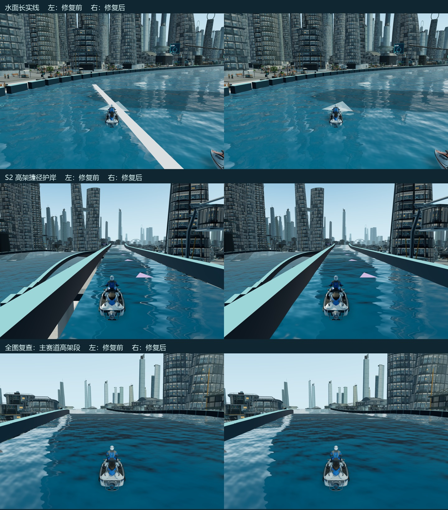

# 水面实线、护岸接缝与性能复查

2026-10-19。本地版已构建，尚未推送或更新 GitHub Pages。

## 视觉修复

- 删除水面起跑长实线，以及捷径上同类的检查点横条；方向箭头、比赛起终点与检查点计分保留。
- 高架水面原本比护岸内侧少铺约 0.55m，导致可看穿到下层城市/支撑。现在水面与底板铺到护岸内部，并把护岸底部向水下延伸，封住波谷与曲线插值产生的小缝。
- 检查了第二条捷径、主赛道高架飞跃段、港湾凸坡、港口落差段。沿全图高架护岸的 1,035 个位置进行几何覆盖检查，原来全部缺少内侧接缝覆盖，修复后全部覆盖，缺口为 0；最小水面/墙底重叠约 0.327m，大于全部视觉波幅之和 0.081m。
- 高架水面三角面仍为 25,176，未增加绘制通道。模型、贴图、反射、阴影分辨率及水面波纹配置保留。

## 性能结果

保留两项优化：水道内部安全行驶时跳过远处捷径投影，距离比较先排除不可能成为最近点的线段；角色阴影只写入实际使用的深度缓冲，并只清除一次深度，去掉无用颜色写入和重复清屏。

- 相同五艇模拟的每步纯计算耗时：0.439 → 0.359 ms，下降 18.2%。该项跳过 GPU 绘制，不能当作实际 FPS。
- 每步投影查询：149.59 → 110.86 次，减少 25.9%。两版行驶终点、路线和比赛状态一致。
- 实际绘制测量：同一 Edge 进程，1600×1000、DPR1、标准画质，修改前/修改后/修改后/修改前顺序；每段 60 帧预热、240 帧采样，实际绘制反射、阴影、全部五艇。

|场景|修复前 FPS|修复后 FPS|变化|P95 帧耗时 ms|
|---|---:|---:|---:|---:|
|城市段五艇|33.81|33.97|+0.47%|35.90 → 35.25|
|S2 高架五艇|36.98|37.18|+0.54%|33.95 → 34.95|

本轮显著减少了计算负担，但平均 FPS 收益有限；高精度快艇、车手和场景的绘制仍构成主要负担，不能宣称所有掉帧已消除。骨骼传输、索引重排、阴影批处理等试验未取得稳定 FPS 收益，未保留在交付代码中。

## 验证

- TypeScript、生产构建、162 项自动化测试通过，包含玩家/AI 三圈、五艇比赛、跳台/飞跃/高低水道隔离。
- 3,912 组合法水面组合、四条浏览器完整行驶路径、24 组低速改道/折返复测通过，未重新引入捷径空气墙。
- 五艇、三种姿态、2048² 阴影图逐字节对照，全部无差异；市区相同镜头画面对照的平均 RGB 字节误差为 0.000505，超过 8 字节差异的像素占比约 0.00194%，改动集中于护岸/被移除横条。
- 浏览器通行测试加速模拟时跳过 GPU 绘制，单独的 FPS 对照使用完整渲染；两种数据分开记录。

本地试玩：[打开游戏](http://127.0.0.1:5183/)。已打开的页面需 Ctrl+F5 刷新加载新构建。线上版本尚未更新。
