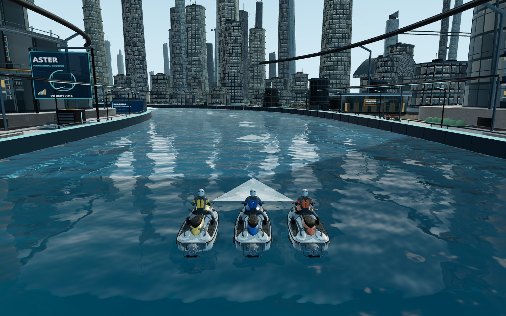
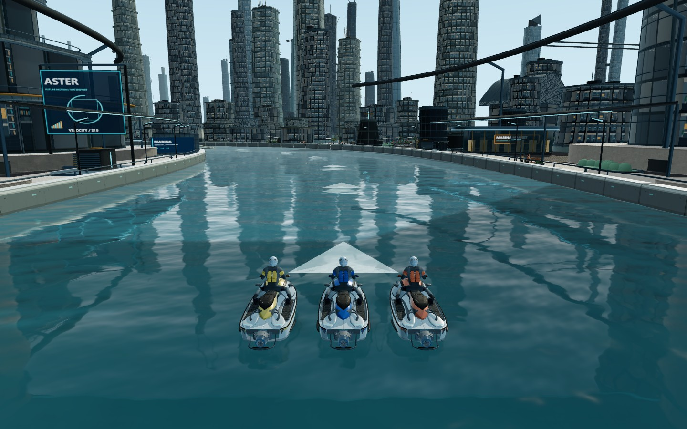
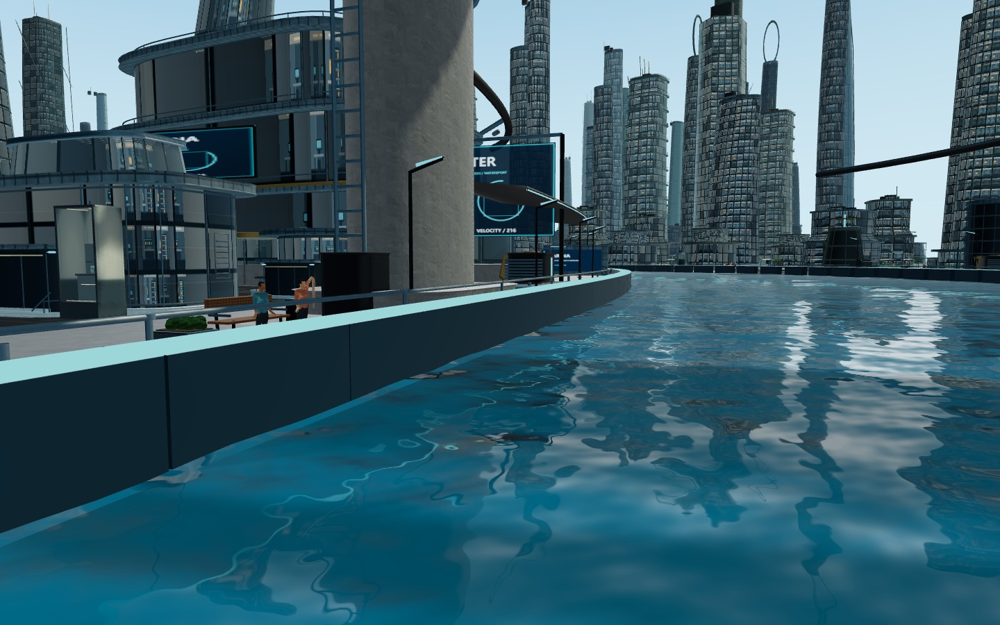
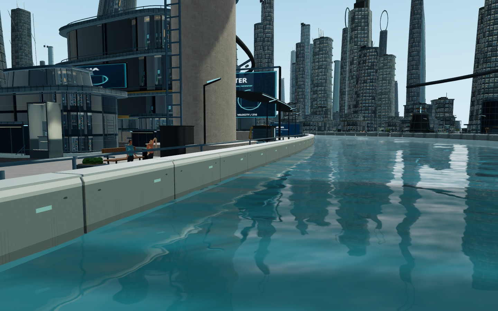
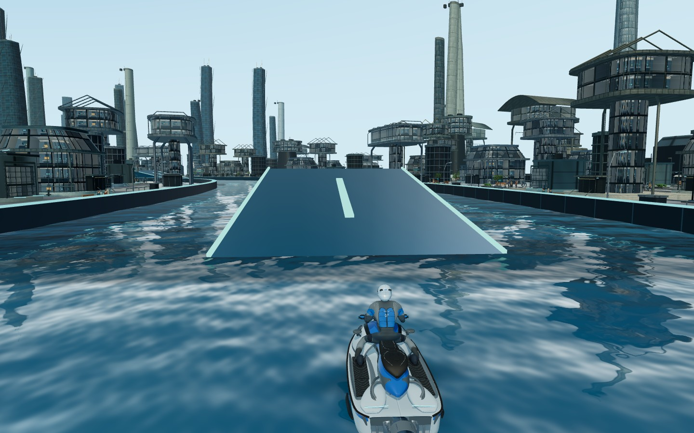
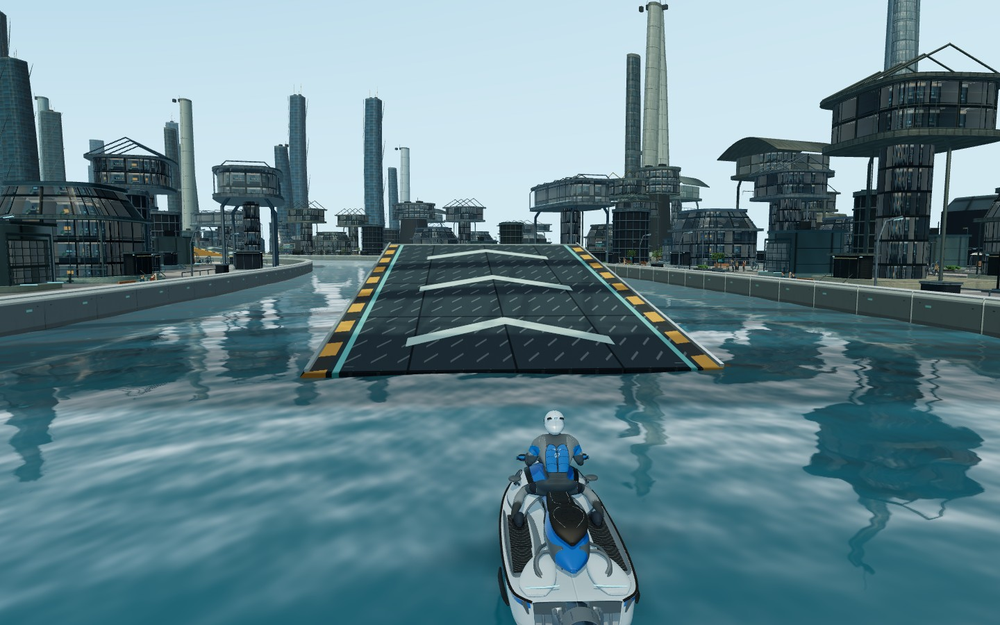
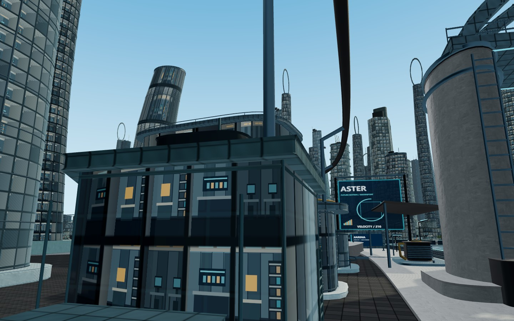
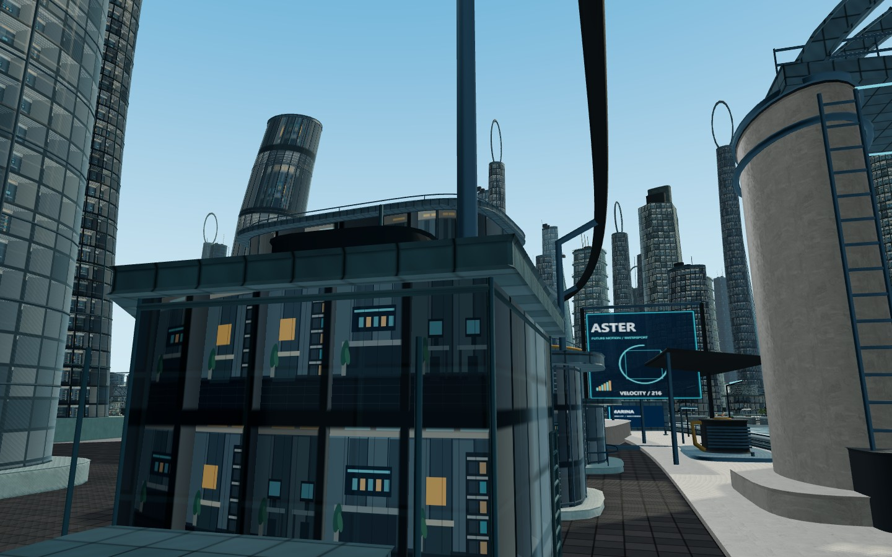

# 全地图视觉精修

基线：`ec1fb7592ace6a3bb62db2954f215ff4a14dd708`。修改前检查点为 `checkpoint/pre-world-detail-20261022`。

## 外观

- 赛道护岸：在原碰撞包围范围内制作真实上缘倒角，沿用原来的水下裙边和捷径开口；增加预制板拼缝、固定点、潮湿水线和小型导向标记。压顶改用银灰材质。
- 六个跳台：按原宽度、长度和坡度制作封闭板体、侧面倒角、金属侧框、纵梁及前缘横梁；加入防滑纹理、箭头、板缝和黄黑警示带。六座跳台仍合并为两个材质组。
- 水面与高架水道：统一校准青蓝水色、大小尺度波纹强度、倒影扰动和太阳高光。保留四层几何波、两次法线采样、32 个尾浪样本、实时倒影及原有各设备分辨率。
- 赛道外建筑与设施：统一陶瓷涂层、拉丝合金、混凝土和石材的 PBR 参数；玻璃采用更合适的表面粗糙度，原室内图集增加窗洞阴影、地板拼缝、吊顶与绿植细节。沿用既有楼体轮廓、密度、实例化、LOD 和共享材质。

护岸与跳台分别使用一张 256² / 512² 的本地生成纹理。颜色与粗糙度打包在 RGBA 中，粗糙度复用颜色采样；不增加法线贴图、透明叠层或独立细节绘制。原有运行时美术文件字节不变，原资源缓存仍可使用，无新增模型下载。

## 性能对照

同一 Edge 进程，以前/后/后/前顺序测试。电脑为 1440×900、DPR1；手机浏览器模拟为 844×390、DPR3，游戏维持原手机绘制预算。每段 60 帧预热、180 帧实际 `Game.frame`；使用相同五艇轨迹，另采集 GPU 定时查询。

| 场景 | 平均帧时间：前 → 后 | 变化 |
| --- | --- | --- |
| 电脑城市五艇 | 29.64 → 30.47 ms | +2.8% |
| 电脑捷径五艇 | 28.97 → 29.83 ms | +3.0% |
| 手机模拟城市五艇 | 20.81 → 20.08 ms | -3.5% |
| 手机模拟捷径五艇 | 22.71 → 21.26 ms | -6.4% |

绘制调用次数一致。含各渲染遍次的三角形增加 76,424，约为所测总量的 0.09%–0.36%；纹理对象增加 2。物理终点、检查点记录、水面网格、倒影及阴影尺寸均逐项一致。短时测试会受 GPU 频率和浏览器调度影响，手机模拟结果不等于实体手机帧率，也不保证所有设备帧率不变。

## 验证

- 245 项 Node 测试通过，包括护岸包围范围、贴图打包、PBR 通道保留、跳台视觉合批及原起跳数据一致性。
- 前端、Node 大厅、Workers 类型检查通过，13 项真实 Workers 测试通过。
- 实际 Game.frame 三圈自动驾驶验证：玩家主路第一圈、S1 第二圈、S2 第三圈；五艇全部达到 72 个检查点并结束，玩家记录 22 次起跳；保存全路线截图及两条捷径记录。该测试是加速回放，按每 12 个物理步绘制一次，不是长期帧率测试。
- 双手机浏览器联机检查加载屏障、同步五秒倒计时、驾驶与对手同步、掉线恢复及退出首页。
- 生产构建成功。正式包没有 QA 接口；公开发布仍须确认 GitHub Actions 成功和线上入口/Game 文件 SHA256 一致。

小型原始记录和前后效果图见本目录；完整截图与日志在忽略目录 `work/world-detail/`。复测入口：`scripts/qa/build-world-detail.mjs`、`world-detail-review.mjs` 和 `world-detail-drive.mjs`。联机复测沿用 `scripts/qa/online-race.mjs`。

## 固定视角效果

| 项目 | 修改前 | 修改后 |
| --- | --- | --- |
| 城市与水面 |  |  |
| 护岸 |  |  |
| 跳台 |  |  |
| 街区建筑 |  |  |
